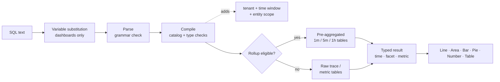

## Abfrage mit SQL: Abfragemechanik {#how-to-query-with-sql-the-mechanics-of-querying}

Bevor Sie ein Tool verwenden, sollten Sie wissen, wie es funktioniert. In diesem Dokument erfahren Sie, wie Sie Ihre Daten untersuchen, was beim Ausführen einer Abfrage geschieht und wie Sie Beispielabfragen von einfach bis komplex durchlaufen.

### Datenexploration

Die beste Möglichkeit, SQL zu verwenden, besteht darin, **Erkunden** zu öffnen und es mit Ihren eigenen Daten zu versuchen.

>[!TIP]
>
> SQL ist schreibgeschützt. Es können keine Daten geändert oder gelöscht werden, und jede Abfrage bezieht sich auf Ihren Mandanten.

1. **Kunden auswählen** Im Mandantenschalter oben in der App benötigt SQL einen einzelnen Mandanten.
2. Öffnen Sie **Erkunden**. Auf **Registerkarte** Visual Builder“ können Sie **Von** (eine Entität), **Aggregat**, **Filter**, **Facet** und **TimeSeries**. Die generierte SQL wird darunter angezeigt.
3. Wechseln Sie zur Registerkarte **SQL**, um die Abfrage direkt zu bearbeiten. Der Editor vervollständigt Entitäten, Attribute und Funktionen bei der Eingabe automatisch.
4. Öffnen Sie das Bedienfeld **Anleitung zur Abfrage** auf der rechten Seite, um Entitäten, Attributtypen und Beispielabfragen zu durchsuchen. Klicken Sie auf ein Beispiel, um es zu laden.
5. Klicken Sie auf **Validieren**, um eine Abfrage zu überprüfen, ohne sie auszuführen, oder **Ausführen** (⌘/Strg + Eingabetaste), um die Ergebnisse anzuzeigen.

Beginnen Sie, indem Sie `FROM` eingeben und eine Entität auswählen, und fügen Sie dann `SELECT` und ein Attribut hinzu:

```sql
FROM Transaction SELECT name, duration LIMIT 20
```

Dies ist eine einfache **Ereignisabfrage**. Es werden 20 eingehende Anfragen zurückgegeben, die den Vorgangsnamen und die Dauer jeder einzelnen Anfrage anzeigen.

Ersetzen Sie nun die Attribute durch **Aggregat** und gruppieren Sie das Ergebnis:

```sql
FROM Transaction SELECT count(*) FACET service
```

Dies zählt Anfragen pro Service und zeigt an, welche Services Berichte erstellen.

>[!IMPORTANT]
>
> **Entdecken vor dem Erstellen.** Die Verfügbarkeit von Attributen hängt davon ab, wie jeder Service instrumentiert ist. Führen Sie [Discovery-Abfragen](#101-data-discovery) zuerst auf einem neuen Mandanten aus, um zu sehen, welche Services, Hosts, Attribute und Metriken tatsächlich Daten enthalten.

### Ausführen einer Abfrage

Wenn Sie eine Abfrage ausführen, Observability Insights:

1. **Ersetzt Variablen** und ersetzt `{{name}}` Token durch die aktuelle Dashboard-Variablenauswahl. Dies geschieht im -Browser, nur in Dashboards.
2. **Analysiert** den Text. Alles, was außerhalb der SQL-Grammatik liegt, wird abgelehnt, einschließlich Semikolons, rohe SQL-Funktionen und Unterabfragen.
3. **Kompiliert** die Abfrage Es ordnet jedes logische Attribut (z. B. `urlPath`) seinem gespeicherten Ausdruck zu und validiert Typen und Funktionen.
4. **Fügt obligatorische** hinzu: Ihr Mandant, das Zeitfenster und der feste Umfang der Entität (z. B. bedeutet `Transaction` nur Server-Bereiche).
5. **Routes** geeignete Zeitreihenabfragen an voraggregierte **Datenaggregationstabellen**. Dies erfolgt automatisch und die Ergebnisse stimmen mit den Rohdaten überein.
6. **Führt** Abfrage mit einem 15-Sekunden-Timeout und einem Byte-Read-Budget aus und gibt dann typisierte Spalten (Zeit, Facette, Metrik) zurück, die von der Benutzeroberfläche gerendert werden.



### Ergebnis-Shapes

Jede Abfrage gibt eine von vier Formen zurück. Die Form entscheidet, welche Diagramme sinnvoll sind.

| Form | Wie man es bekommt | `LIMIT` | Optimale Visualisierung |
| --------------- | ---------------------------------------------------- | --------------- | ------------------ |
| **Reklametafel** | Nur Aggregate ohne `FACET` und ohne `TIMESERIES` | 1 | Zahl |
| **Facet** | Aggregate + `FACET` | 10 | Bar, Kuchen, Tisch |
| **Zeitreihe** | Aggregate + `TIMESERIES` (mit oder ohne `FACET`) | 5.000 Zeilen | Linie, Fläche, Balken |
| **Ereignisse** | Nur unformatierte Attribute | 100 | Tabelle |

<a id="time-window-precedence"></a>

### Zeitfensterpriorität

| Wo die Abfrage ausgeführt wird | Welches Fenster gilt |
| --------------------------------- | ---------------------------------------------------------------------------------- |
| **Dashboard-Widget** | Das Dashboard **Zeitauswahl**. `SINCE`/`UNTIL` in der Abfrage werden ignoriert. |
| **Widget-Vorschau hinzufügen** | Die Zeitauswahl im Dialogfeld **Widget hinzufügen**. |
| **Erkunden** | Die globale Zeitauswahl. `SINCE`/`UNTIL` werden ignoriert, wenn ein Auswahlbereich aktiv ist. |
| **API ohne expliziten Bereich** | `SINCE`/`UNTIL` in der Abfrage, standardmäßig die letzte Stunde. |

>[!NOTE]
>
> Da die Auswahl in Dashboards und beim Erkunden gewinnt, werden in diesem Handbuch in der Regel `SINCE` aus Dashboard-Abfragen ausgeschlossen. Für die Abfragen sollte immer eine Zeitauswahl definiert werden.
