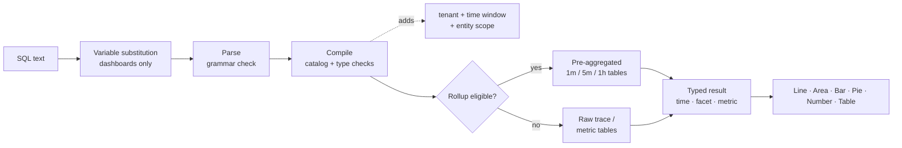

<a id="top"></a>

# Dokumentation zum Adobe Observability Insights-Dashboard/zur Abfrage

**Adobe Observability Insights Query Language (SQL)** - Abfrage, Diagramm und Dashboard Ihrer Telemetrie in Adobe Observability Insights.

|                |                                                                  |
| -------------- | ---------------------------------------------------------------- |
| **Gilt für** | Insights-Benutzeroberfläche → **Erkunden** und **Dashboards** (benutzerdefinierte Dashboards) |
| **Zielgruppe** | Ingenieure, SREs und Power-User, die SQL kennen |

>[!TIP]
> Jeder Code-Block mit der Kennzeichnung `sql` ist eine SQL-Abfrage, die Sie direkt in **Erkunden → SQL** oder in **Dashboards → Widget hinzufügen → SQL** einfügen können.

## Dokumentationskarte

| Abschnitt | doc | Lerninhalt |
| --------------- | ----------------------------------------------------------------------------------- | ------------------------------------------------------------------------------------------- |
| **Erste Schritte** | [1. Erste Schritte mit SQL](#1-get-started-with-SQL-the-language-of-your-telemetry) | Was SQL ist, was Sie abfragen können, wo Sie es verwenden können, die Grundregeln |
|                 | [2. Abfragen mit SQL](#2-how-to-query-with-SQL-the-mechanics-of-querying) | Erkunden von Daten, Ausführen einer Abfrage, Beispiele |
|                 | [3. Diagramme und Dashboards](#3-charts-and-dashboards-visualizing-your-data) | So wandeln Sie Abfragen in Diagramme um und erstellen Dashboards Schritt für Schritt |
| **Verweis** | [4. SQL-Referenz](#4-SQL-reference) | Jede Klausel, Funktion und Operator, mit Beispielen |
|                 | [5. Datenwörterbuch](#5-data-dictionary) | Jede Entität und jedes Attribut, das Sie abfragen können |
| **Tutorials** | [6. Tutorial 1: Ihre ersten Abfragen](#6-tutorial-1-your-first-queries) | `SELECT`, `FROM`, `LIMIT`, Aggregate, Zeit, `TIMESERIES`, `WHERE`, `FACET` |
|                 | [7. Tutorial 2: Steuern Sie Ihre Daten](#7-tutorial-2-control-your-data) | Eindeutige Werte, Neueste/Früheste, Prozentsätze, Perzentile, Kennzeichnungen, Platzhalter, Reihenfolge |
|                 | [8. Tutorial 3: Erweitern des Dashboards](#8-tutorial-3-advance-your-dashboarding) | Bedingte Aggregate, Apdex, Raten, Histogramme, Formeln, Variablen, Abschnitte |
|                 | [9. Tutorial 4: Erweiterte ](#9-tutorial-4-advanced-functions) | `stddev`, `derivative`, Rang-`latest`, Anteil an der Gesamtsumme, span-Komposition, Metrikerkennung |
| **Beispiele** | [10. Abfrage-Cookbook](#10-query-cookbook) | Über 100 einsatzbereite Abfragen nach Thema (einschließlich AEM) |
|                 | [11. Dashboard-Blueprints](#11-dashboard-blueprints) | Zehn vollständige, komplexe Dashboards mit der Abfrage jedes Widgets |
| **Bedienen** | [12. Leistung](#12-performance) | Datenaggregationen, Abfragebudgets und wie man Dashboards schnell hält |
|                 | [13. Fehlerbehebung](#13-troubleshooting) | Jede Fehlermeldung, was sie bedeutet und wie sie behoben werden kann |
|                 | [14. Anhang](#14-appendix) | Beschränkungen, Dateiformat exportieren, einseitige Schnellübersicht |

# Erste Schritte

## &#x200B;1. Erste Schritte mit SQL: die Sprache Ihrer Telemetrie

SQL ist eine SQL-ähnliche Abfragesprache für Ihre Observability Insights-Daten. Es ist dieselbe Sprache hinter jedem benutzerdefinierten Dashboard-Widget und der Seite **Erkunden**, sodass Sie die Ansichten erstellen können, die Ihr Team benötigt.

SQL arbeitet mit **Entitäten** zusammen, die benutzerfreundliche logische Ansichten wie `Transaction`, `Span` oder `CpuUtilization` sind. Sie fragen Speichertabellen nie direkt ab. Observability Insights kompiliert jede SQL-Abfrage in einer sicheren, parametrisierten Warehouse-Abfrage. Diese Abfrage gilt immer für Ihren Mandanten und das ausgewählte Zeitfenster.

```sql
SELECT count(*) AS requests FROM Transaction TIMESERIES AUTO
```

### Was Sie mit SQL tun können

SQL verwenden für:

- **Build-Diagramme** mit Durchsatz, Fehlerrate, Latenz, Apdex, CPU, Arbeitsspeicher, JVM-Heap, Festplatte und Netzwerk im Zeitverlauf.
- **Beantworten Sie spezifische**, z. B. „Welche URL-Pfade auf der Veröffentlichungsebene haben die schlechtesten p95?“ oder „Welche nachgelagerte Domain schlägt fehl?“
- **Untersuchen Sie Vorfälle** indem Sie von einem KPI bis hin zu einzelnen Anfragen und Trace-IDs bohren.
- **Dashboards erstellen** mit KPIs, Trends, Tabellen, Formeln, Anmerkungen, Abschnittsüberschriften und Variablen.
- **Profile AEM Workloads** (Adobe Experience Manager) mit den Attributen Sling, JSP, JCR, Dispatcher und GraphQL.

SQL unterstützt sowohl **Ereignisabfragen**, die einzelne Anfragezeilen zurückgeben, als auch **Aggregatabfragen**, die Gesamtsummen, Perzentile, Raten, Aufschlüsselungen und Zeitreihen zurückgeben.

>[!TIP]
> Die Vorlagen in **Dashboards → Dashboard erstellen** werden vollständig aus SQL erstellt. Öffnen Sie ein beliebiges Vorlagen-Widget mit dem Stiftsymbol, um die zugehörige Abfrage anzuzeigen und daraus zu lernen.

### Was Sie abfragen können

SQL kann vier Datenfamilien abfragen. Die vollständige Liste finden Sie unter [Datenwörterbuch](#5-data-dictionary).

| Familie | Entitäten | Typische Fragen |
| ------------------------------------ | ------------------------------------------------------------------------------------------------------------------------------------------------------------------ | -------------------------------------------------------------------- |
| **TRACES (APM)** | `Transaction` (eingehende Anfragen), `AppRequest` (Anfragen + Nachrichtenkonsumenten), `Span` (alle Bereiche) | Durchsatz, Latenz, Fehler, APDEX, nachgelagerte Aufrufe, AEM-Codepfade |
| **Kuratierte Host- und Laufzeitmetriken** | `CpuUtilization`, `MemoryUtilization`, `LoadAverage5m`, `DiskUtilization`, `NetworkReceiveRate`, `JvmHeapUsed`, `JvmThreadCount`, `DispatcherRequestRate` und mehr | Sättigung, Kapazität, JVM-Status, Dispatcher-Auslastung |
| **Generische Metriken** | `MetricGauge`, `MetricSum` | Beliebige OpenTelemetry-Metriken nach Name, Metrikerkennung |
| **Voraggregierte span-Komposition** | `SpanBreakdown` | Welche untergeordneten Vorgänge eine Transaktion bilden |

>[!NOTE]
> Protokolle, Warnhinweisdefinitionen und Inventarbeziehungen sind nicht verfügbar.

### Verwendung von SQL

| Dabei gilt | Anleitung zum Öffnen | Wofür es ist |
| ----------------------- | ------------------------------------------------------------------------------ | ------------------------------------------------------------------------------------------------------------------------------------------------------------------------------------ |
| **Erkunden** | Linke Navigation → **Erkunden** | Ad-hoc-Analyse. Verwenden Sie den **Visual Builder** oder die **SQL**-Registerkarte **Validieren** dann **Ausführen** (⌘/Strg+Eingabe). Enthält **Verlauf** und **Gespeicherte** Abfragen und ein Bedienfeld **Anleitung für Abfragen**. |
| **Dashboards** | Die linke Navigation → **Dashboards** → ein Dashboard öffnen oder erstellen → **Widget hinzufügen** | Beständige Diagramme, KPIs und Tabellen, kombiniert in Dashboards. |
| **Formel-Widgets** | **Widget → Formel hinzufügen** | Kombinieren Sie 2-6 SQL-Abfragen mit Arithmetik (Verhältnisse, Reserven, Abbrandraten). |
| **Dashboard-Variablen** | **+ Variable → aus einer Abfrage** | Füllen Sie eine Auswahl aus den unterschiedlichen Werten einer SQL `FACET`-Abfrage. |
| **Abfragenprüfung** | Bewegen Sie den Mauszeiger über ein Diagramm → überprüfen Sie die Abfrage | SQL hinter einem integrierten Diagramm oder Dashboard-Diagramm anzeigen. |

### SQL-Abfragestruktur

SQL folgt einer auf einer Klausel basierenden Syntax. Diese Abfrage zählt alle eingehenden Anfragen im ausgewählten Fenster:

```sql
SELECT count(*) FROM Transaction
```

Im Folgenden finden Sie alle verfügbaren Klauseln:

```text
SELECT  function(attribute) [FILTER (WHERE condition)] [AS alias] [, ...]
        | attribute [AS alias] [, ...]
FROM    Entity
  [WHERE      condition [AND | OR ...]]
  [FACET      attribute [, attribute ...]]        -- up to 5
  [SINCE      n unit [AGO]]
  [UNTIL      NOW | n unit [AGO]]
  [TIMESERIES AUTO | MAX | n unit]
  [ORDER BY   alias [ASC | DESC]]
  [LIMIT      number]                              -- 1 to 5000
```

Im Folgenden finden Sie die SQL-Regeln:

| Regel | Details |
| ---------------------------- | ------------------------------------------------------------------------------------------------------------------------------------------------------------------------------------ |
| **Erforderliche Klauseln** | `SELECT` und `FROM` sind erforderlich. Jede andere Klausel ist optional. Sie können mit einem der folgenden Elemente beginnen: `FROM Transaction SELECT count(*)` ist auch gültig. |
| **Klauselreihenfolge** | Die Klauseln nach `FROM` können in beliebiger Reihenfolge angezeigt werden. Jede Klausel darf nur einmal angezeigt werden. |
| **Abfragengröße** | Eine Abfrage muss 4 KB oder weniger betragen. |
| **Groß-/Kleinschreibung** | Bei Schlüsselwörtern, Funktionsnamen, Entitätsnamen und Attributnamen wird **Groß-** Kleinschreibung unterschieden. Bei Zeichenfolgenwerten **wird zwischen** Groß- und Kleinschreibung unterschieden (`'Error'` ≠ `'error'`). |
| **Zeichenfolgen** | Verwenden Sie einfache Anführungszeichen: `WHERE status = 'Error'`. Um ein Zitat einzuschließen, verdoppeln Sie es: `'O''Brien'`. Doppelte Anführungszeichen werden nicht akzeptiert. |
| **Literale** | Zeichenfolgen, Zahlen (einschließlich Negativ- und Dezimalzahlen), `TRUE`, `FALSE`, `NULL`. |
| **Attributnamen** | Namen können Buchstaben, Ziffern, `_` und `.` enthalten (zum Beispiel `http.statusCode`). Es sind keine Backticks erforderlich. |
| **Aggregate vs. Attribute** | Bei einer Abfrage werden entweder Rohattribute (eine Ereignisliste) oder Aggregate ausgewählt, aber nie beides. Verwenden Sie zum Gruppieren `FACET`. |
| **Zeitfenster** | Der Standardwert ist die letzte Stunde. Die maximale Wartezeit beträgt 31 Tage. In Dashboards und im Explorer **die** das Fenster (siehe [Zeitfenster](#time-window-precedence)). |
| **Nicht unterstützt** | Semikolons, Kommentare, Unterabfragen, Joins, `SELECT *`, Mathematik zwischen Attributen in `SELECT`, `HAVING`, `COMPARE WITH`. Siehe [Was SQL nicht tut](#what-SQL-doesnt-do) für Alternativen. |

### Nächste Schritte

- [Abfragen mit SQL](#2-how-to-query-with-SQL-the-mechanics-of-querying): Erkunden Sie Daten und verstehen Sie, wie Abfragen ausgeführt werden.
- [Diagramme und Dashboards](#3-charts-and-dashboards-visualizing-your-data): Visualisieren Sie Ihre Ergebnisse.
- [Tutorial 1: Ihre ersten ](#6-tutorial-1-your-first-queries): Eine praktische Anleitung.
- [SQL-Referenz](#4-SQL-reference): Vollständige Syntax, Klauseln und Funktionen.

[↑ Nach oben](#top)

## &#x200B;2. Abfrage mit SQL: Abfragemechanik

Bevor Sie ein Tool verwenden, sollten Sie wissen, wie es funktioniert. In diesem Dokument erfahren Sie, wie Sie Ihre Daten untersuchen, was beim Ausführen einer Abfrage geschieht und wie Sie Beispielabfragen von einfach bis komplex durchlaufen.

### Datenexploration

Die beste Möglichkeit, SQL zu verwenden, besteht darin, **Erkunden** zu öffnen und es mit Ihren eigenen Daten zu versuchen.

>[!TIP]
> SQL ist schreibgeschützt. Es können keine Daten geändert oder gelöscht werden, und jede Abfrage bezieht sich auf Ihren Mandanten.

1. **Kunden auswählen** Im Mandantenschalter oben in der App benötigt SQL einen einzelnen Mandanten.
2. Öffnen Sie **Erkunden**. Auf **Registerkarte** Visual Builder“ können Sie **Von** (eine Entität), **Aggregat**, **Filter**, **Facet** und **TimeSeries**. Die generierte SQL wird darunter angezeigt.
3. Wechseln Sie zur Registerkarte **SQL**, um die Abfrage direkt zu bearbeiten. Der Editor vervollständigt Entitäten, Attribute und Funktionen bei der Eingabe automatisch.
4. Öffnen Sie das Bedienfeld **Anleitung zur Abfrage** auf der rechten Seite, um Entitäten, Attributtypen und Beispielabfragen zu durchsuchen. Klicken Sie auf ein Beispiel, um es zu laden.
5. Klicken Sie auf **Validieren**, um eine Abfrage zu überprüfen, ohne sie auszuführen, oder **Ausführen** (⌘/Strg + Eingabetaste), um die Ergebnisse anzuzeigen.

Beginnen Sie, indem Sie `FROM` eingeben und eine Entität auswählen, und fügen Sie dann `SELECT` und ein Attribut hinzu:

```sql
FROM Transaction SELECT name, duration LIMIT 20
```

Dies ist eine einfache **Ereignisabfrage**. Es werden 20 eingehende Anfragen zurückgegeben, die den Vorgangsnamen und die Dauer jeder einzelnen Anfrage anzeigen.

Ersetzen Sie nun die Attribute durch **Aggregat** und gruppieren Sie das Ergebnis:

```sql
FROM Transaction SELECT count(*) FACET service
```

Dies zählt Anfragen pro Service und zeigt an, welche Services Berichte erstellen.

>[!IMPORTANT]
> **Entdecken vor dem Erstellen.** Die Verfügbarkeit von Attributen hängt davon ab, wie jeder Service instrumentiert ist. Führen Sie [Discovery-Abfragen](#101-data-discovery) zuerst auf einem neuen Mandanten aus, um zu sehen, welche Services, Hosts, Attribute und Metriken tatsächlich Daten enthalten.

### Ausführen einer Abfrage

Wenn Sie eine Abfrage ausführen, Observability Insights:

1. **Ersetzt Variablen** und ersetzt `{{name}}` Token durch die aktuelle Dashboard-Variablenauswahl. Dies geschieht im -Browser, nur in Dashboards.
2. **Analysiert** den Text. Alles, was außerhalb der SQL-Grammatik liegt, wird abgelehnt, einschließlich Semikolons, rohe SQL-Funktionen und Unterabfragen.
3. **Kompiliert** die Abfrage Es ordnet jedes logische Attribut (z. B. `urlPath`) seinem gespeicherten Ausdruck zu und validiert Typen und Funktionen.
4. **Fügt obligatorische** hinzu: Ihr Mandant, das Zeitfenster und der feste Umfang der Entität (z. B. bedeutet `Transaction` nur Server-Bereiche).
5. **Routes** geeignete Zeitreihenabfragen an voraggregierte **Datenaggregationstabellen**. Dies erfolgt automatisch und die Ergebnisse stimmen mit den Rohdaten überein.
6. **Führt** Abfrage mit einem 15-Sekunden-Timeout und einem Byte-Read-Budget aus und gibt dann typisierte Spalten (Zeit, Facette, Metrik) zurück, die von der Benutzeroberfläche gerendert werden.



### Ergebnis-Shapes

Jede Abfrage gibt eine von vier Formen zurück. Die Form entscheidet, welche Diagramme sinnvoll sind.

| Form | Wie man es bekommt | `LIMIT` | Optimale Visualisierung |
| --------------- | ---------------------------------------------------- | --------------- | ------------------ |
| **Reklametafel** | Nur Aggregate ohne `FACET` und ohne `TIMESERIES` | 1 | Zahl |
| **Facet** | Aggregate + `FACET` | 10 | Bar, Kuchen, Tisch |
| **Zeitreihe** | Aggregate + `TIMESERIES` (mit oder ohne `FACET`) | 5.000 Zeilen | Linie, Fläche, Balken |
| **Ereignisse** | Nur unformatierte Attribute | 100 | Tabelle |

<a id="time-window-precedence"></a>

### Zeitfensterpriorität

| Wo die Abfrage ausgeführt wird | Welches Fenster gilt |
| --------------------------------- | ---------------------------------------------------------------------------------- |
| **Dashboard-Widget** | Das Dashboard **Zeitauswahl**. `SINCE`/`UNTIL` in der Abfrage werden ignoriert. |
| **Widget-Vorschau hinzufügen** | Die Zeitauswahl im Dialogfeld **Widget hinzufügen**. |
| **Erkunden** | Die globale Zeitauswahl. `SINCE`/`UNTIL` werden ignoriert, wenn ein Auswahlbereich aktiv ist. |
| **API ohne expliziten Bereich** | `SINCE`/`UNTIL` in der Abfrage, standardmäßig die letzte Stunde. |

>[!NOTE]
> Da die Auswahl in Dashboards und beim Erkunden gewinnt, werden in diesem Handbuch in der Regel `SINCE` aus Dashboard-Abfragen ausgeschlossen. Für die Abfragen sollte immer eine Zeitauswahl definiert werden.

### SQL-Abfragebeispiele

Hier ein vollständiges Beispiel. Für diese Abfrage:

- Sie wählen `Transaction` als Entität.
- Mit `SELECT` berechnen Sie die Dauer des 95. Perzentils.
- Die Ergebnisse werden nach Dienst in `FACET` gruppiert.
- Verwenden Sie `TIMESERIES AUTO`, um die Daten über ein Intervall mit automatischer Größe darzustellen.

```sql
FROM Transaction SELECT percentile(duration, 95) AS p95 FACET service TIMESERIES AUTO
```

Dadurch wird pro Dienst eine Zeile in einem Liniendiagramm erzeugt, wobei standardmäßig die 10 meistgenutzten Dienste angezeigt werden.

Klicken Sie auf die einzelnen unten stehenden Beispiele, um sie zu erweitern.

<details>
<summary><strong>Einfache Abfrage eingehender Anfragen</strong></summary>

Durchschnittliche Reaktionszeit aller eingehenden Anfragen in Millisekunden:

```sql
SELECT average(duration) FROM Transaction
```

</details>

<details>
<summary><strong>Attributnamen, die Punkte enthalten</strong></summary>

Punktierte Namen müssen nicht in Anführungszeichen gesetzt werden:

```sql
SELECT count(*) FROM Transaction WHERE http.statusCode >= 500 FACET http.route
```

</details>

<details>
<summary><strong>Abfrage gibt mehrere Spalten zurück</strong></summary>

Mehrere Aggregate in einer Abfrage werden zu Spalten in einer Tabelle:

```sql
SELECT count(*) AS requests, average(duration) AS avgMs, percentile(duration, 95) AS p95, max(duration) AS maxMs FROM Transaction FACET service
```

</details>

<details>
<summary><strong>Bedingte Aggregate in einem Durchgang</strong></summary>

Gesamt, Fehler und 5xx nebeneinander:

```sql
SELECT count(*) AS total, count(*) FILTER (WHERE status = 'Error') AS errors, count(*) FILTER (WHERE http.statusCode >= 500) AS http5xx FROM Transaction FACET service
```

</details>

<details>
<summary><strong>Abfrage einer kuratierten Metrik</strong></summary>

Durchschnittliche CPU pro Host im Zeitverlauf:

```sql
SELECT average(value) AS cpu FROM CpuUtilization FACET host TIMESERIES AUTO
```

</details>

<details>
<summary><strong>Abfragen einer OpenTelemetry-Metrik nach Namen</strong></summary>

Verwenden Sie `MetricGauge`/`MetricSum` für Metriken ohne kuratierte Entität:

```sql
SELECT latest(value) AS bytesUsed FROM MetricSum WHERE metric = 'jvm.memory.used' FACET host, pool
```

</details>

<a id="what-SQL-doesnt-do"></a>

### Was SQL nicht tut

SQL ist bewusst klein. Dadurch bleiben Abfragen sicher, schnell und Mandanten-isoliert. Wenn Sie eine dieser Funktionen benötigen, verwenden Sie die Alternative .

| Funktion | Status | Alternative |
| ------------------------------------------- | ------------- | ------------------------------------------------------------------------------------------------------------ |
| `SELECT *` | Nicht unterstützt | Listen Sie die gewünschten Attribute auf: `SELECT timestamp, name, duration, traceId …`. |
| Mischung von Rohattributen und Aggregaten | Nicht unterstützt | Verwenden Sie `FACET attr` oder `latest(attr)` / `earliest(attr)`. |
| Mathematik in `SELECT` (`a - b`, `count(*) / 60`) | Nicht unterstützt | **Formel**-Widget (Dashboards). |
| Joins und Unterabfragen | Nicht unterstützt | **Formel**-Widget oder zwei Widgets nebeneinander. |
| `HAVING` | Nicht unterstützt | `ORDER BY alias` + `LIMIT`. |
| `COMPARE WITH` | Nicht unterstützt | Ändern Sie die Zeitauswahl oder legen Sie zwei Widgets auf verschiedene Registerkarten. |
| `FACET CASES` | Nicht unterstützt | Eine `count(*) FILTER (WHERE …)` Spalte pro Fall (siehe [Tutorial 3](#83-group-values-into-cases-with-filter)). |
| `histogram()` | Nicht unterstützt | Spalten mit `FILTER` in Buckets (siehe [Tutorial 3](#84-build-a-latency-histogram)). |
| `uniques()` / `keyset()` | Nicht unterstützt | `FACET attr LIMIT n` listet verschiedene Werte auf. Discovery-Abfragen listen Metriken und ausgefüllte Attribute auf. |
| `RLIKE` (Regex) | Nicht unterstützt | `LIKE` / `NOT LIKE` mit `%` und `_` Platzhaltern oder `IN (…)`. |
| Kommentare (`--`, `//`, `/* */`) | Nicht unterstützt | Fügen Sie Notizen in den Widget-Titel oder ein **Text**-Widget ein. |
| Absolute Daten in `SINCE` | Nicht unterstützt | Absoluten Bereich der Zeitauswahl verwenden. |
| Typenkonvertierung (`numeric()`, `string()`) | Nicht erforderlich | Attribute werden in den Katalog eingegeben. |

[↑ Nach oben](#top)

## &#x200B;3. Diagramme und Dashboards: Visualisieren Ihrer Daten

Bei Abfragen werden die benötigten Informationen gefunden. Diagramme und Dashboards machen diese Informationen für Ihr Unternehmen nützlich. Dieses Dokument zeigt, wie SQL-Ergebnisse zu Diagrammen werden und wie Dashboards erstellt, organisiert und freigegeben werden.

### Diagramme

Jedes SQL-Ergebnis kann als einer von sechs Diagrammtypen dargestellt werden.

| Diagrammtyp | Verwenden Sie ihn für | Form der Abfrage |
| --------------- | --------------------------------------------------- | ----------------------------------------------- |
| **line** | Trends im Zeitverlauf, eine Zeile pro Facettenwert | Aggregat + `TIMESERIES` |
| **Bereich** | Volumen im Zeitverlauf, z. B. Durchsatz nach Service | Aggregat + `TIMESERIES` |
| **bar** | Kategorien vergleichen; Zeitreihen mit geringer Dichte | Aggregat + `FACET` (± `TIMESERIES`) |
| **Torte/Ringdiagramm** | Anteil eines Ganzen (Status-Code-Mix, Traffic nach Ebene) | Ein Aggregat + `FACET`, wenige Werte |
| **Zahl** | Ein einzelner KPI mit optionalen Farbschwellenwerten | Reklametafel (nur Aggregate) |
| **Tabelle** | Mehrere Aggregate pro Gruppe oder Ereignislisten | Mehrere Aggregate + `FACET` oder Rohattribute |

Nachdem sich ein Widget in einem Dashboard befindet, haben Sie folgende Möglichkeiten:

- **Bearbeiten** die Abfrage, den Titel, den Diagrammtyp und die Einheit (Stiftsymbol).
- **Duplizieren** um eine Variante zu erstellen, z. B. dasselbe Diagramm für eine andere Ebene.
- **CSV herunterladen** der aktuellen Zeilen oder **PNG** mit 2× Auflösung.
- **Ziehen Sie** am Griffpunkt und **ändern** Sie ihn von der rechten unteren Ecke.

### Dashboards

Diagramme funktionieren für sich genommen gut, aber Dashboards bringen sie zusammen. Ein Dashboard ist eine benannte, für Mandanten bestimmte Sammlung von **Registerkarten**. Jede Registerkarte ist ein 12-spaltiges Raster aus **Widgets**.

| Konzept | Bedeutung |
| --------------- | ------------------------------------------------------------------------------------------------------------------------------- |
| **Dashboard** | Eine benannte Sammlung von 1-40 Registerkarten, die Server-seitig für den ausgewählten Mandanten gespeichert werden. |
| **Registerkarte** | Ein Raster von Widgets (bis zu 200). Benennen Sie ihn mit dem Stift um, löschen Sie ihn mit × und fügen Sie einen mit **+** hinzu. Mindestens eine Registerkarte muss bestehen bleiben. |
| **Widget** | Eine **einzelne Abfrage**, eine **Formel** oder **Text** (eine Anmerkung oder eine ausblendbare Abschnittskopfzeile). |
| **Variable** | Eine Auswahl über dem Raster. Sein Wert wird als `{{name}}` eingefügt. |
| **Zeitauswahl** | Das Fenster für jedes Widget im Dashboard. |

### Schritt für Schritt ein Dashboard erstellen

#### Schritt 1: Bevor Sie beginnen

- **Wählen Sie im Mandanten-** einen einzelnen Kunden aus. **Dashboard erstellen** ist deaktiviert, während **Alle Konten** ausgewählt ist. SQL kann nicht für den Demo-Mandanten ausgeführt werden.
- **ROLES.** Jeder Benutzer mit Dashboard-Zugriff kann Widgets hinzufügen, bearbeiten und speichern. Das Erstellen oder Bearbeiten **Variablen** und das Überprüfen der Abfrage eines Widgets ist auf **Organisations-** und **Superadmins** beschränkt.

#### Schritt 2: Dashboard erstellen

1. Öffnen Sie **Dashboards** im linken Navigationsbereich.
2. Klicken Sie **Dashboard erstellen**.
3. Startpunkt wählen:

   | Option | Was Sie erhalten |
   | ---------------------------- | -------------------------------------------------------------------------------------------------------- |
   | **Erstellen eines benutzerdefinierten Dashboards** | Ein leeres Dashboard mit einer Registerkarte. |
   | **Grundlagen zu CPU** | Host und Prozess-CPU (user/system/iowait/steal), Durchsatz, Last, Apdex. |
   | **All-in-One-Übersicht** | KPIs (Volumen, Fehler %, Apdex, p95), Fehler-/Traffic-Pies, CPU-/Speichertabellen, JVM-Threads, langsame Vorgänge. |
   | **Top-Transaktionen** | Apdex, p95 nach Vorgang, Host-seitige Last/CPU, langsamste Transaktionen mit Trace-IDs, HTTP-Fehleraufschlüsselung. |

4. Geben Sie einen **Namen** ein und bestätigen Sie. Die Dashboard-Arbeitsfläche wird geöffnet.

#### Schritt 3: Die Arbeitsfläche kennenlernen

| Bereich | Steuerung |
| ---------------------------- | --------------------------------------------------------------------------------------------------------- |
| **Obere Leiste** | **Widget hinzufügen**, **Anleitung** (In-App-Spickzettel), **Importieren**, **Exportieren**, **Speichern**, Zeitauswahl und aktualisieren |
| **Variablenleiste** | Mandanten-Badge, eine Auswahl pro Variable, **+ Variable** (Administratoren) |
| **Registerkartenleiste** | Registerkarten wechseln; umbenennen (Bleistift), löschen (×), hinzufügen (+) |
| **Raster** | 12 Spalten. Widgets am Griff ziehen, Größe von der Ecke ändern (mindestens 2×2). |
| **Widget-Kopfzeile** (beim Bewegen des Mauszeigers) | CSV herunterladen, PNG herunterladen, bearbeiten, duplizieren, entfernen, Griff ziehen |

>[!IMPORTANT]
> **Speichern ist explizit.** Layout-Änderungen, neue Widgets, Registerkarten und Variablen verbleiben im Browser, bis Sie auf &quot;**&quot;**. Die Schaltfläche _Speichern… → gespeichert_ oder _Speichern fehlgeschlagen_ (siehe [Fehlerbehebung](#13-troubleshooting)).

#### Schritt 4: Widget hinzufügen

Klicken Sie **Widget hinzufügen**. Das Dialogfeld verfügt über drei Modi: **Einzelabfrage**, **Formel** und **Text**. Es verfügt auch über eine eigene Zeitauswahl, sodass Sie eine Vorschau des Widgets für jedes Fenster anzeigen können.

**Option A: der Builder (kein Code)**

1. _(Optional)_ **Mit einem Helper beginnen**: Wählen Sie eine von 57 Vorgaben, gruppiert als Golden Signals, APM, AEM, Transactions, Traces &amp; Spans, Infrastructure, Publishers, JVM &amp; Runtime und Data Discovery. Eine Voreinstellung füllt den Titel, die Abfrage, den Diagrammtyp und die Einheit aus.
2. **Anzeigen**: Wählen Sie `Count`, `Average`, `Percentile` (und seine Ebene), `Sum`, `Min`, `Max` oder `Unique count` und dann ein Attribut aus.
3. **Von**: Wählen Sie die Entität aus.
4. **Filter**: Zeilen von `attribute operator value` hinzufügen (`=`, `!=`, `>`, `<`, `>=`, `<=`, `LIKE`). Alle Zeilen werden mit `AND` kombiniert.
5. **Gruppieren nach**: Wählen Sie ein Facettenattribut und **Top N**, um nur die geschäftigste Serie zu behalten.
6. **Im Zeitverlauf**: Schaltet `TIMESERIES` ein, mit einer **alle N Minuten** Behältergröße.
7. Überprüfen Sie die generierte SQL unter dem Formular und klicken Sie dann auf **Abfrage ausführen**.

**Option B: der SQL-Editor**

1. Wechseln Sie den Umschalter von **Builder** zu **SQL**. Das Bearbeiten eines vorhandenen Widgets wird immer in SQL geöffnet.
2. Geben Sie eine Abfrage ein oder fügen Sie sie ein. Der Editor wird automatisch im Live-Katalog ausgefüllt.
3. Verwenden Sie das Bedienfeld **Handbuch zur Abfrage**, um Entitäten, Attribute und Beispiele zu durchsuchen.
4. Klicken Sie **Abfrage ausführen**. Sie sehen, _`<Entity>`Abfrage gültig ist_ eine Live-Vorschau und eine Zusammenfassung (`N rows · N time points · N groups`). Eine _Serie_ Warnung wird angezeigt, wenn weniger als drei Zeitpunkte vorliegen.

>[!TIP]
> Der Builder behandelt die häufigsten Abfragen. Zu SQL wechseln für `apdex`, `percentage`, `rate`, `FILTER`, mehrere Aggregate, `OR`, `IN`, mehrere Facetten oder `ORDER BY`.

#### Schritt 5: Konfigurieren des Erscheinungsbilds

| Feld | Anmerkungen |
| --------------------- | ----------------------------------------------------------------------------------------------------------------------------------------------------------------------- |
| **Titel** | Bis zu 200 Zeichen. Kann `{{variable}}` Token enthalten. |
| **Diagrammtyp** | `Line`, `Area`, `Bar`, `Pie / Donut`, `Number`, `Table`. Nach jedem Durchlauf wird ein Diagrammtyp empfohlen, bis Sie selbst einen auswählen. |
| **Einheit** | Optional, bis zu 40 Zeichen (`ms`, `%`, `req/s`, `MB`, `bytes`). Lassen Sie es leer, um die abgeleitete Einheit zu verwenden (z. B. `ms` für `duration`, `%` für `CpuUtilization`). |
| **Farbschwellen** | Nur Zahl-Widgets. Bis zu 10 Bänder der Form _at oder höher `value` → Grün / Amber / Rot_. Die höchste passende Band gewinnt. |

#### Schritt 6: Speichern Sie zuerst das Widget und dann das Dashboard

**Widget speichern** wird erst aktiviert, nachdem eine Ausführung Daten zurückgibt. Neue Widgets bestehen aus 6 Spalten × 3 Zeilen und werden jeweils zwei pro Zeile gepackt. Ordnen Sie sie an und klicken Sie dann **Speichern** in der oberen Leiste.

### Wählen des richtigen Diagramms

| Form der Abfrage | Bestes Diagramm | Vorteile |
| ------------------------------------------------- | ------------------- | ---------------------------------------------- |
| Ein Aggregat, kein `FACET`, kein `TIMESERIES` | **Zahl** | Eine einzelne Kachel KPI; Hinzufügen von Schwellenwerten. |
| Aggregat + `TIMESERIES` | **LINE**/**AREA** | Ein Trend; eine Reihe pro Facettenwert. |
| Aggregat + `FACET` (wenige Werte) | **bar**/**pie** | Vergleicht Kategorien; Kuchen als Anteil eines Ganzen. |
| Mehrere Aggregate + `FACET` | **Tabelle** | Jedes Aggregat wird zu einer Spalte. |
| Rohattribute | **Tabelle** | Eine Ereignisliste. |
| Aggregat + `FACET` + `TIMESERIES` auf wenigen Daten | **bar** | Liest besser als glückliche Zeilen. |

Wenn die einzelne Zeile eines Zahlen-Widgets einen Textwert enthält (z. B. `latest(host)`), wird das Widget als Untertitel angezeigt.

### Text-Widgets: Anmerkungen und Abschnittsüberschriften

**Widget → Text hinzufügen**:

- **Hinweis**: Nur Text (bis zu 4.000 Zeichen, Leerzeilen werden beibehalten). Verwenden Sie es für Runbook-Links, Eigentümer und SLO-Definitionen. `{{variables}}` werden gerendert.
- **Bereichs-**: Häkchen _Erstellen Sie eine Bereichs-_. Es erstreckt sich über die gesamte Breite und sein Pfeil reduziert jedes Widget darunter bis zur nächsten Abschnittsüberschrift. Verwenden Sie sie für Gruppierungen wie **PUBLISH**, **AUTHOR** und **DISPATCHER**.

>[!TIP]
> Widget-Titel, die auf `- PUBLISH` oder `- AUTHOR` enden, erhalten einen subtilen Farbhinweis, der das Scannen von AEM-Dashboards nach Ebene erleichtert.

### Die Zeitauswahl

- Damit wird das Fenster für **alle**-Widget und für abfragebasierte Variablenoptionen festgelegt.
- In Widget-Abfragen wird `SINCE`/`UNTIL` überschrieben.
- Das maximale Fenster beträgt **31 Tage**.
- `TIMESERIES AUTO` passt seine Behältergröße an das Fenster an.
- Der Untertitel jedes Widgets zeigt das tatsächlich angewendete Fenster an, z. B. _Seit vor 1 Stunde_.
- Die Ergebnisse werden 30 Sekunden lang zwischengespeichert. Verwenden Sie die Schaltfläche „Aktualisieren“, um eine erneute Ausführung zu erzwingen.

### Variablen

Mit Variablen kann ein Dashboard mehrere Kontexte bereitstellen, z. B. jeweils einen Service, eine Umgebung oder einen Schwellenwert. Sie werden in ([ 3) ](#87-make-dashboards-reusable-with-variables).

>[!WARNING]
> **Bekannte Einschränkung im aktuellen Build:** `{{variables}}` in Widgets **Titel** und **Text-Widgets**. Innerhalb des Widgets **SQL** werden sie im Dashboard gerendert, aber die **Widget hinzufügen** -Vorschau und die Server-seitige **Speichern**-Prüfung lehnen das Roh-`{{name}}`-Token mit `Unexpected character '{'` ab. Bis dies behoben ist, verwenden Sie Literalwerte in Widget-Abfragen und verwenden Sie **Duplizieren** um Varianten zu erstellen.

### Formel-Widgets

Eine Formel kombiniert 2-6 benannte SQL-Abfragen arithmetisch, z. B. `(errors / total) * 100`. Verwenden Sie eine Option, wenn ein KPI mehr als eine Abfrage erfordert, z. B. ein Verhältnis, Reserven, eine Summe der Raten oder eine Brennrate. Siehe [Tutorial ](#86-combine-queries-with-formula-widgets).

### Freigeben, Exportieren und Importieren

| Aktion | Funktion |
| ------------- | ------------------------------------------------------------------------------------------------------------------------------------------------------------------------- |
| **Speichern** | Behält den Namen, die Registerkarten, Widgets, das Layout und die Variablen bei. Jede Widget-Abfrage wird Server-seitig erneut validiert. Bei einem ungültigen Widget schlägt die gesamte Speicherung fehl. |
| **Export** | Downloads `<dashboard-name>.json` (Registerkarten, Widgets, Variablen). |
| **Import** | Lädt einen JSON-Export **in das geöffnete Dashboard** und ersetzt dessen Registerkarten und Variablen. Klicken Sie dann auf **Speichern**. Tipp: Erstellen Sie zuerst ein leeres Dashboard und importieren Sie es dann in das Dashboard. |
| **CSV/PNG** | Downloads pro Widget aus der Widget-Kopfzeile. |

>[!TIP]
> Mit dem Export und Import können Sie Dashboards zur Versionskontrolle in Git verwenden und ein Dashboard von einem Kunden zum anderen weiterleiten. Das Dateiformat wird im [Anhang](#142-export-file-format) beschrieben.

### Tipps für die Leistung von Dashboards und Diagrammen

- **Verwenden Sie Tabellen für große** anstelle von Balken oder Vielreihen-Linien.
- **Teilen Sie belegte Dashboards in Registerkarten auf.** Nur die Widgets der sichtbaren Registerkarte werden ausgeführt.
- **Immer Facettenabfragen `LIMIT`** insbesondere bei Attributen mit hoher Kardinalität wie `urlPath`, `traceId` und `jcr.path`.
- **Filtern Sie früh** nach Attributen mit niedriger Kardinalität (`service`, `kind`, `status`).
- **Bevorzugen Sie`TIMESERIES AUTO`**, um kleine Behälter zu fixieren, und vermeiden Sie `TIMESERIES MAX`, außer über ein paar Minuten.
- **Entwerfen Sie langfristige Trends für Datenaggregationen.** Siehe [Leistung](#12-performance).

[↑ Nach oben](#top)

# Referenz

## &#x200B;4. SQL-Referenz

Diese Referenz behandelt SQL-Syntax, -Klauseln, -Funktionen und -Operatoren. Erweitern Sie jeden Eintrag, um Details und Beispiele anzuzeigen.

**In diesem Dokument:** [Abfragekomponenten](#41-query-components) ・ [Erforderliche Klauseln](#42-required-clauses) ・ [Optionale Klauseln](#43-optional-clauses) ・ [Aggregatorfunktionen](#44-aggregator-functions) ・ [Operatoren und Bedingungen](#45-operators-and-conditions) ・ [Typbehandlung](#46-type-handling-blank-vs-null) ・ [SQL zu SQL](#47-translate-sql-to-SQL) ・ [NRQL zu SQL](#48-translate-nrql-to-SQL)

### 4.1 Abfragekomponenten

```text
SELECT <select-item> [, <select-item> ...]
FROM   <Entity>
[WHERE      <condition>]
[FACET      <attribute> [, <attribute> ...]]          -- up to 5
[SINCE      <n> <unit> [AGO]]
[UNTIL      NOW | <n> <unit> [AGO]]
[TIMESERIES AUTO | MAX | <n> <unit>]
[ORDER BY   <alias-or-selected-name> [ASC | DESC]]
[LIMIT      <1..5000>]

<select-item> := <function>(<args>) [FILTER (WHERE <condition>)] [AS <alias>]
               | <attribute> [AS <alias>]
<unit>        := second | seconds | minute | minutes | hour | hours | day | days | week | weeks
```

>[!NOTE]
> Die oben genannten `--` Anmerkungen dienen nur der Dokumentation. SQL selbst akzeptiert keine Kommentare.

### 4.2 Erforderliche Klauseln

<details>
<summary><code>SELECT</code> — Was zurückgegeben werden soll</summary>

`SELECT` listet entweder **Raw-Attribute** (eine Ereignisabfrage) oder **Aggregatorfunktionen** (eine Aggregatabfrage) auf. Man kann die beiden nicht vermischen.

| Formular | Beispiel | Ergebnis |
| ------------ | -------------------------------------------------- | ------------------------------------------------- |
| Attribute | `SELECT timestamp, name, duration` | Zeilen mit einzelnen Ereignissen (Standard: 100) |
| Aggregate | `SELECT count(*), average(duration)` | Ein Wert pro Aggregat (pro Facetten-/Zeitbereich) |
| Mit Aliassen | `SELECT count(*) AS requests` | `requests` der Spaltentitel |
| Zitatalias | `SELECT percentile(duration, 95) AS 'p95 latency'` | Titel mit Leerzeichen |

Ereignisliste:

```sql
SELECT timestamp, service, name, duration, status, traceId FROM Transaction WHERE status = 'Error' LIMIT 50
```

Mehrere Aggregate:

```sql
SELECT count(*) AS requests, average(duration) AS avgMs, max(duration) AS maxMs FROM Transaction
```

Regeln:

- `SELECT *` wird nicht unterstützt. Listen Sie die gewünschten Attribute auf.
- Die Mathematik zwischen Attributen oder Aggregaten (`sum(a) / count(*)`) wird nicht unterstützt. Verwenden Sie ein [Formel-Widget](#86-combine-queries-with-formula-widgets).
- Das Mischen von Attributen und Aggregaten schlägt mit fehl _Rohattribute können nicht mit Aggregaten gemischt werden; verwenden Sie FACET, um Ergebnisse zu gruppieren_.

</details>

<details>
<summary><code>FROM</code> - Welche Entität abgefragt werden soll</summary>

`FROM` benennt genau **eine** Entität aus dem [Datenwörterbuch](#5-data-dictionary). Beim Entitätsnamen wird nicht zwischen Groß- und Kleinschreibung unterschieden.

```sql
SELECT count(*) FROM Transaction
```

```sql
FROM Span SELECT count(*) FACET kind
```

Jede Entität hat einen festen Umfang. Zum Beispiel ist `Transaction` immer Serverspannen und `CpuUtilization` ist immer die Metrik &quot;CPU-beschäftigt“, wobei `value` in Prozent konvertiert wird. Sie können nicht mehr als eine Entität in einer Abfrage abfragen. Um Entitäten zu kombinieren, verwenden Sie ein [Formel-Widget](#86-combine-queries-with-formula-widgets).

</details>

### 4.3 Optionale Klauseln

<details>
<summary><code>AS</code> - eine Spalte kennzeichnen</summary>

Verwenden Sie `AS`, um einem Aggregat oder Attribut einen lesbaren Namen zu geben. Der Alias wird zur Spaltenüberschrift, Legendenbezeichnung und zum Namen, auf den Sie in `ORDER BY` verweisen.

```sql
SELECT count(*) AS requests, percentile(duration, 95) AS p95 FROM Transaction FACET service ORDER BY p95 DESC LIMIT 10
```

Verwenden Sie für Beschriftungen mit Leerzeichen eine Zeichenfolge in Anführungszeichen:

```sql
SELECT percentile(duration, 95) AS 'p95 latency (ms)' FROM Transaction TIMESERIES AUTO
```

</details>

<details>
<summary><code>FACET</code> — Gruppenergebnisse</summary>

`FACET` gruppiert Ergebnisse nach bis zu **5** Attributen, z. B. SQL-`GROUP BY`.

```sql
SELECT count(*) FROM Transaction FACET service, http.method, http.statusCode LIMIT 30
```

| Abfrage | `LIMIT n` bedeutet | Standard |
| ---------------------------- | ----------------------------------------------------------------------------------------------------------------------------- | --------------------------------- |
| `FACET` ohne `TIMESERIES` | Anzahl Zeilen | 10 |
| `FACET` mit `TIMESERIES` | **Top n Reihe**, sortiert nach der Summe des ersten Aggregats über das gesamte Fenster. Jedes Mal, wenn Eimer für diese Serie aufbewahrt wird. | Alle Reihen (begrenzt auf 5.000 Zeilen) |

Facettierte Zeitreihen, Top 5:

```sql
SELECT count(*) AS requests FROM Transaction FACET service TIMESERIES AUTO LIMIT 5
```

Facettenwerte können Zeichenfolgen oder Zahlen sein. Leere Zeichenfolgen bilden eine eigene Gruppe. Mit `WHERE attr != ''` ausschließen.

</details>

<details>
<summary><code>FILTER</code> — Bedingte Aggregate</summary>

Hängen Sie `FILTER (WHERE condition)` an ein Aggregat an, um es über eine Teilmenge von Zeilen zu berechnen. Auf diese Weise können Sie mehrere Bedingungen in einem Durchgang vergleichen.

```sql
SELECT count(*) AS total, count(*) FILTER (WHERE status = 'Error') AS errors, percentile(duration, 95) FILTER (WHERE http.method = 'GET') AS getP95 FROM Transaction FACET service LIMIT 20
```

`FILTER` ist mit `apdex`, `rate` oder `derivative` nicht zulässig. `percentage` nimmt bereits einen eigenen Zustand an.

</details>

<details>
<summary><code>LIMIT</code> — Anzahl der Zeilen oder Reihen</summary>

`LIMIT` benötigt eine positive Ganzzahl. Werte über 5.000 werden auf 5.000 beschränkt.

| Ergebnisform | Standard |
| ------------ | ---------- |
| Reklametafel | 1 |
| Facetteneffekt | 10 |
| Zeitreihe | 5.000 Zeilen |
| Ereignisse | 100 |

```sql
SELECT count(*) FROM Transaction FACET urlPath LIMIT 50
```

>[!TIP]
> Legen Sie immer eine `LIMIT` für abfragebasierte Variablen und Facetten mit hoher Kardinalität fest (`urlPath`, `traceId`, `jcr.path`, `url`).

</details>

<details>
<summary><code>ORDER BY</code> — Ergebnisse sortieren</summary>

`ORDER BY` sortiert nach einem **ausgewählten Alias oder ausgewählten Attribut**. Die Standardrichtung ist `DESC`.

```sql
SELECT count(*) AS requests, percentile(duration, 95) AS p95 FROM Transaction FACET name ORDER BY p95 DESC LIMIT 20
```

| Ergebnisform | Standardreihenfolge |
| ----------------- | --------------------------------------------------------------------------- |
| Reklametafel/Facette | Erstes Aggregat, `DESC` |
| Zeitreihe | Zeit, `ASC` |
| Ereignisse | Erste ausgewählte Spalte, `DESC` (setzen Sie also `timestamp` für „Newest First“ an erste Stelle) |

Regeln:

- Wenn auf etwas verwiesen wird, das nicht ausgewählt ist, schlägt dies mit _ORDER BY &#39;x&#39; fehl und muss auf einen ausgewählten Wert oder Alias verweisen_.
- `ORDER BY` nicht zu einer `TIMESERIES` Abfrage hinzufügen. Sie überschreibt die für Diagramme erforderliche Zeitreihenfolge.

</details>

<details>
<summary><code>SINCE</code> — Start des Fensters</summary>

`SINCE n unit [AGO]` legt fest, wie weit das Fenster zurück beginnt. Einheiten: `second`, `minute`, `hour`, `day`, `week` (im Singular oder im Plural). `AGO` ist optional.

```sql
SELECT count(*) FROM Transaction SINCE 6 hours ago
```

- Der Standardwert lautet `SINCE 1 hour ago`.
- Das Fenster darf nicht länger **31 Tage** sein (_Zeitraum darf 31 Tage nicht überschreiten_).
- Absolute Datumswerte (`SINCE '2026-01-01'`) und `TODAY`/`YESTERDAY` werden nicht unterstützt.

>[!IMPORTANT]
> In Dashboards und im Explorer überschreibt **Zeitauswahl** `SINCE` und `UNTIL`. Siehe [Zeitfensterpriorität](#time-window-precedence).

</details>

<details>
<summary><code>TIMESERIES</code> — Diagramm im Zeitverlauf</summary>

`TIMESERIES` gibt eine Zeile pro Zeitbehälter (pro Facettenwert) zurück, die für Linien-, Flächen- oder Balkendiagramme bereit ist.

| Formular | Bucket-Größe |
| ---------------------- | --------------------------------------------------------------------------------------------------------------------------------------------- |
| `TIMESERIES 5 minutes` | Genau das, was Sie verlangen (beliebige Einheit) |
| `TIMESERIES AUTO` | Über Fenster ÷ 120, aufgerundet auf 1s / 5s / 10s / 15s / 30s / 1m / 5m / 10m / 15m / 30m / 1h / 3h / 6h / 12h / 1d. **Nie unter 2 Minuten.** |
| `TIMESERIES MAX` | 1-Sekunden-Buckets. Nur über wenige Minuten verwenden. |

Typische `AUTO`:

| Fenster | 1 h | 6 h | 24 Stunden | 7 T | 30 T |
| ------ | ----- | ----- | ------ | --- | ---- |
| Bucket | 2 Min | 5 Min | 15 Min | 3 Std | 6 h |

```sql
SELECT percentile(duration, 95) AS p95 FROM Transaction TIMESERIES AUTO
```

```sql
SELECT count(*) FROM Transaction TIMESERIES 1 hour SINCE 1 day ago
```

>[!TIP]
> Bevorzugte `AUTO` in Dashboards. Es hat ungefähr 120 Punkte, was auch immer die Zeitauswahl sagt. Außerdem werden „zersplitterte“ Zeilen pro Host vermieden, da Host-Metriken etwa alle 90 Sekunden abgekratzt werden.

</details>

<details>
<summary><code>UNTIL</code> — Ende des Fensters</summary>

`UNTIL NOW` (Standard) oder `UNTIL n unit [AGO]`. Kombinieren Sie es mit `SINCE`, um ein vergangenes Fenster zu betrachten:

```sql
SELECT count(*) AS yesterday FROM Transaction SINCE 2 days ago UNTIL 1 day ago
```

`SINCE` muss vor `UNTIL` liegen. Andernfalls schlägt die Abfrage mit fehl _SINCE muss vor UNTIL liegen_.

</details>

<details>
<summary><code>WHERE</code> — Zeilen filtern</summary>

`WHERE` speichert nur Zeilen, die einer Bedingung entsprechen. Kombinieren Sie Bedingungen mit `AND`, `OR`, `NOT` und Klammern. Siehe [Operatoren und Bedingungen](#45-operators-and-conditions).

```sql
SELECT count(*) FROM Transaction WHERE service = 'checkout' AND (status = 'Error' OR http.statusCode >= 500)
```

`WHERE` kann nur einmal angezeigt werden. Geben Sie alle Bedingungen hinein.

</details>

### 4.4 Aggregatorfunktionen

| Funktion | Argumente | Rückgabe | Funktioniert am |
| -------------------------------------- | ----------------------------------- | ---------------------- | ------------------------------------- |
| [`apdex`](#fn-apdex) | Numerische Dauer, Schwellenwert `T` | 0-1 | Entitäten verfolgen |
| [`average` / `avg`](#fn-average) | Numerisch | Gleiche Einheit wie Eingang | Alle |
| [`count`](#fn-count) | `*` oder Attribut | Anzahl Zeilen | Alle |
| [`derivative`](#fn-derivative) | Numerisch | Änderung pro Sekunde | Beliebig (`TIMESERIES` erforderlich) |
| [`earliest`](#fn-latest) | Beliebige [, Rang] | Attributwert | Alle |
| [`latest`](#fn-latest) | Beliebige [, Rang] | Attributwert | Alle |
| [`max` / `min`](#fn-minmax) | Beliebig | Gleiche Einheit wie Eingang | Alle |
| [`percentage`](#fn-percentage) | `*` oder Attribut, `WHERE` Bedingung | % | Alle |
| [`percentile`](#fn-percentile) | Numerisch, Ebene `p` | Gleiche Einheit wie Eingang | Alle |
| [`percentOfTotal`](#fn-percentoftotal) | Numerisch | % | Beliebig (keine `TIMESERIES`) |
| [`rate`](#fn-rate) | numerischer Zähler | pro Sekunde | Zählerentitäten (benötigt `TIMESERIES`) |
| [`stddev`](#fn-stddev) | Numerisch | Gleiche Einheit wie Eingang | Alle |
| [`sum`](#fn-sum) | Numerisch | Gleiche Einheit wie Eingang | Alle |
| [`uniqueCount`](#fn-uniquecount) | Beliebig | Unterschiedliche Werte | Alle |

<a id="fn-apdex"></a>

<details>
<summary><code>apdex(attribute, T)</code></summary>

Berechnet einen [Apdex](https://www.apdex.org/)-Wert von 0 (frustriert) bis 1 (zufrieden) anhand des Schwellenwerts `T` der Einheit des Attributs (Millisekunden für `duration`).

| Bucket | Bedingung | Gewichtung |
| ---------- | ------------------------------------ | ------ |
| zufrieden | `duration ≤ T` und kein Fehler | 1 |
| erträglich | `T < duration ≤ 4T` und kein Fehler | 0.5 |
| frustriert | `duration > 4T` oder **Fehler** | 0 |

```sql
SELECT apdex(duration, 500) AS apdex FROM Transaction FACET service
```

- Funktioniert nur mit Ablaufverfolgungsentitäten (`Transaction`, `AppRequest`, `Span`).
- `T` muss größer als 0 sein. `FILTER` ist nicht erlaubt.
- `apdex(duration, 500)` auf `Transaction` wird über lange Zeitfenster hinweg rollup-beschleunigt.

</details>

<a id="fn-average"></a>

<details>
<summary><code>average(attribute)</code> / <code>avg(attribute)</code></summary>

Das arithmetische Mittel eines numerischen Attributs.

```sql
SELECT average(duration) AS avgMs FROM Transaction FACET service TIMESERIES AUTO
```

</details>

<a id="fn-count"></a>

<details>
<summary><code>count(*)</code> / <code>count(attribute)</code></summary>

- `count(*)` zählt Zeilen.
- `count(attribute)` zählt Zeilen, bei denen das Attribut **NOT NULL** ist. Bei Zeichenfolgenattributen sind fehlende Werte leer (`''`) und nicht NULL, sodass sie weiterhin gezählt werden (siehe [Typenverarbeitung](#46-type-handling-blank-vs-null)).

```sql
SELECT count(*) AS requests, count(http.statusCode) AS withStatusCode FROM Transaction
```

</details>

<a id="fn-derivative"></a>

<details>
<summary><code>derivative(attribute)</code></summary>

Die Änderung der `average(attribute)` pro Sekunde zwischen aufeinander folgenden Buckets: (dieser Bucket − vorheriger Bucket) ÷ Bucket Sekunden. Das Ergebnis kann negativ sein. Verwenden Sie ihn auf Messgeräten, um zu sehen, ob ein Wert wächst oder schrumpft.

```sql
SELECT derivative(value) AS heapGrowthPerSec FROM JvmHeapUsed WHERE host = 'publish-1' TIMESERIES 5 minutes
```

- Erfordert `TIMESERIES` und muss das **Aggregat**. `FILTER` ist nicht erlaubt.
- Der erste Bucket hat keinen Vorgänger.

</details>

<a id="fn-latest"></a>

<details>
<summary><code>latest(attribute [, rankAttribute])</code> / <code>earliest(…)</code></summary>

- `latest(attr)` Gibt den Wert aus der letzten Zeile zurück. `earliest(attr)` gibt den Wert aus der ältesten Zeile zurück.
- Bei einem zweiten Argument wird die Zeile durch dieses Attribut anstelle von Zeit ausgewählt. `latest(traceId, duration)` gibt die Ablaufverfolgungs-ID der **langsamsten)** zurück. `earliest(traceId, duration)` gibt die schnellste zurück.

```sql
SELECT latest(value) AS current FROM MemoryUtilization FACET host
```

```sql
SELECT max(duration) AS slowestMs, latest(traceId, duration) AS slowestTrace FROM Transaction FACET name ORDER BY slowestMs DESC LIMIT 10
```

</details>

<a id="fn-minmax"></a>

<details>
<summary><code>max(attribute)</code> / <code>min(attribute)</code></summary>

Der größte oder kleinste Wert. Funktioniert mit Zahlen, Zeichenfolgen und Zeitstempeln.

```sql
SELECT min(duration) AS fastestMs, max(duration) AS slowestMs, max(timestamp) AS lastSeen FROM Transaction FACET service
```

</details>

<a id="fn-percentage"></a>

<details>
<summary><code>percentage(*, WHERE condition)</code></summary>

Der Anteil der Zeilen, die `condition` entsprechen, von 0 bis 100.

```sql
SELECT percentage(*, WHERE status = 'Error') AS errorPct FROM Transaction FACET service TIMESERIES AUTO
```

```sql
SELECT percentage(*, WHERE duration > 2000) AS slowPct FROM Transaction
```

`percentage` hat einen eigenen Zustand, es braucht also keine `FILTER`.

</details>

<a id="fn-percentile"></a>

<details>
<summary><code>percentile(attribute, p)</code></summary>

Das ungefähre p-te Perzentil, wobei `0 < p ≤ 100`. Verwenden Sie eine `percentile` pro Ebene.

```sql
SELECT percentile(duration, 50) AS p50, percentile(duration, 95) AS p95, percentile(duration, 99) AS p99 FROM Transaction TIMESERIES AUTO
```

P50, P95 und P99 auf `Transaction` sind rollup-beschleunigt über lange Fenster.

</details>

<a id="fn-percentoftotal"></a>

<details>
<summary><code>percentOfTotal(attribute)</code></summary>

Der Anteil jeder Facettenzeile an der **Gesamtsumme** eines numerischen Attributs. Die Zeilen summieren sich zu 100 %.

```sql
SELECT sum(duration) AS totalMs, percentOfTotal(duration) AS shareOfTime FROM Transaction FACET name LIMIT 15
```

Nicht zulässig mit `TIMESERIES`.

</details>

<a id="fn-rate"></a>

<details>
<summary><code>rate(attribute)</code></summary>

Die Rate pro Sekunde eines **kumulativen Zählers**. In jedem Bucket nimmt `rate` den höchsten Zählerstand pro Serie und vergleicht ihn mit dem vorherigen Bucket. Zählerzurücksetzungen werden bei 0 gesetzt, und der erste Bucket ist 0.

```sql
SELECT rate(value) AS bytesPerSec FROM NetworkReceiveRate FACET host TIMESERIES AUTO
```

- Funktioniert nur bei Zählerentitäten (✔ im [Datenwörterbuch) ](#53-curated-metric-entities).
- Erfordert `TIMESERIES` und muss das **Aggregat**. `FILTER` ist nicht erlaubt.

>[!WARNING]
> Immer `FACET host` oder auf einen einzelnen Host filtern. Eine facettenlose `rate()` über viele Hosts hinweg vergleicht die Zähler verschiedener Hosts und erzeugt bedeutungslose Zahlen. Datenträgerzähler sind pro Gerät, daher ist `FACET host, device` am genauesten.

</details>

<a id="fn-stddev"></a>

<details>
<summary><code>stddev(attribute)</code></summary>

Die Stichprobenstandardabweichung. Verwenden Sie sie mit `average`, um zu beurteilen, wie konsistent die Latenz ist.

```sql
SELECT average(duration) AS avgMs, stddev(duration) AS stddevMs FROM Transaction FACET name LIMIT 20
```

</details>

<a id="fn-sum"></a>

<details>
<summary><code>sum(attribute)</code></summary>

Die Summe eines numerischen Attributs.

```sql
SELECT sum(callCount) AS calls FROM SpanBreakdown FACET segment LIMIT 20
```

</details>

<a id="fn-uniquecount"></a>

<details>
<summary><code>uniqueCount(attribute)</code></summary>

Die **exakte** Anzahl der eindeutigen Werte.

```sql
SELECT uniqueCount(host) AS hosts, uniqueCount(traceId) AS traces FROM Transaction FACET service
```

</details>

Funktionsbeschränkungen auf einen Blick:

| Beschränkung | Funktionen |
| ------------------------------------- | ----------------------------------------------------------------------------------------- |
| Numerisches Attribut erforderlich | `average`, `sum`, `percentile`, `stddev`, `percentOfTotal`, `rate`, `derivative`, `apdex` |
| Keine `FILTER (WHERE …)` | `apdex`, `rate`, `derivative`, `percentage` |
| Erfordert `TIMESERIES`, nur Aggregat | `rate`, `derivative` |
| Nicht mit `TIMESERIES` | `percentOfTotal` |
| Nur Entitäten verfolgen | `apdex` |
| Nur Zählerentitäten | `rate` |

### 4.5 Betreiber und Bedingungen

| Operator | Bedeutung | Beispiel |
| ------------------------- | -------------------------------------------------------------------------- | ---------------------------------------- |
| `=` | Gleich | `status = 'Error'` |
| `!=`, `<>` | Ungleich | `kind != 'Internal'` |
| `<`, `<=`, `>`, `>=` | Vergleich | `http.statusCode >= 500` |
| `LIKE` | Wildcard match: `%` = beliebige Zeichen, `_` = ein Zeichen. Von Schreibweise abhängig. | `urlPath LIKE '/content/%'` |
| `NOT LIKE` | Negierter Platzhalter | `urlPath NOT LIKE '%.css'` |
| `IN (…)` | Entspricht einem der Werte 1-100 | `service IN ('checkout', 'cart')` |
| `NOT IN (…)` | Entspricht keinem der Werte | `http.method NOT IN ('OPTIONS', 'HEAD')` |
| `IS NULL` / `IS NOT NULL` | Null-Prüfung | `http.statusCode IS NOT NULL` |
| `AND`, `OR`, `NOT` | Logik | `NOT (status = 'Ok')` |
| `( … )` | Gruppierung | `(a = 1 OR b = 2) AND c = 3` |

```sql
SELECT count(*) FROM Transaction WHERE (status = 'Error' OR duration > 2000) AND NOT host LIKE '%dispatcher%' AND http.method IN ('GET', 'POST')
```

>[!WARNING]
> `attr = NULL` Fehler. Verwenden von `attr IS NULL`.

### 4.6 Umgang mit Typen: leer vs. NULL

Jedes Attribut hat einen Typ im Katalog: `string`, `number`, `boolean` oder `timestamp`. Der SQL-Typ vergleicht Funktionen (z. B. wird `average(service)` zurückgewiesen). Es sind keine Typkonvertierungsfunktionen erforderlich oder verfügbar.

>[!IMPORTANT]
> **Leer vs. NULL.** Die meisten Zeichenfolgenattribute stammen aus OpenTelemetry-Attributzuordnungen, bei denen ein _fehlender_-Schlüssel als leere `''` und nicht als `NULL` gelesen wird. Um nur Bereiche beizubehalten, die ein -Attribut tragen, verwenden Sie **`attr != ''`** statt `IS NOT NULL`. Numerische Attribute wie `http.statusCode` werden in der Abwesenheit wirklich `NULL`, sodass `IS NOT NULL` für sie funktioniert.

```sql
SELECT count(*) AS jcrCalls FROM Span WHERE jcr.operation != '' FACET jcr.operation
```

### 4.7 SQL in SQL übersetzen

| SQL | SQL |
| ------------------------------------------------------------ | ------------------------------------------------------------------- |
| `WHERE ts > now() - INTERVAL 1 HOUR` | Nichts. Die Zeitauswahl (oder `SINCE 1 hour ago`) legt das Fenster fest. |
| `GROUP BY service` | `FACET service` |
| `GROUP BY toStartOfInterval(ts, INTERVAL 5 MINUTE), service` | `FACET service TIMESERIES 5 minutes` |
| `quantile(0.95)(duration)` | `percentile(duration, 95)` |
| `countIf(status = 'Error')` | `count(*) FILTER (WHERE status = 'Error')` |
| `100 * countIf(x) / count()` | `percentage(*, WHERE x)` |
| `count(DISTINCT host)` | `uniqueCount(host)` |
| `argMax(traceId, duration)` | `latest(traceId, duration)` |
| `x / sum(x) OVER ()` | `percentOfTotal(x)` |
| `ORDER BY p95 DESC LIMIT 20` | `ORDER BY p95 DESC LIMIT 20` |
| `HAVING count() > 100` | _Nicht unterstützt_. Stattdessen sortieren und `LIMIT`. |
| `JOIN`/Unterabfrage | _Nicht unterstützt_. Verwenden Sie ein **Formel**-Widget. |
| `CASE WHEN` | _Nicht unterstützt_. Verwenden Sie `FILTER` Spalten oder `WHERE … LIKE` + `FACET`. |

### 4.8 Importieren eines vorhandenen Dashboards in Insights

Wenn Sie die vorhandene Abfrage kennen, finden Sie im Folgenden die Migrationsdetails

| Vorhandene Abfrage | SQL | Anmerkungen |
| ------------------------------------------- | ------------------------------------------------------------------ | ------------------------------------------------------------ |
| `FROM Transaction SELECT count(*)` | Gleich | `FROM` erste Reihenfolge wird unterstützt |
| `SINCE 1 day ago` | Gleich | In Dashboards ignoriert; die Auswahl gewinnt |
| `TIMESERIES AUTO` / `MAX` / `5 minutes` | Gleich | `AUTO` ist 2 Minuten |
| `FACET appName` | `FACET appName` / `FACET service` |                                                              |
| `percentage(count(*), WHERE error IS true)` | `percentage(*, WHERE status = 'Error')` |                                                              |
| `filter(count(*), WHERE …)` | `count(*) FILTER (WHERE …)` | SQL-Standardformular |
| `apdex(duration, t: 0.5)` | `apdex(duration, 500)` | `duration` ist in **ms** |
| `latest(x)` / `earliest(x)` | Gleich | Plus eine Rangform: `latest(x, rankAttr)` |
| `uniqueCount(x)` | Gleich | Exakt |
| `rate(count(*), 1 minute)` | `count(*)` mit `TIMESERIES 1 minute` | SQL `rate()` ist nur für Zähler |
| `derivative(x, 1 minute)` | `derivative(x)` + `TIMESERIES` | pro Sekunde |
| `uniques(x)` | `count(*) … FACET x LIMIT n` |                                                              |
| `keyset()` / `SHOW EVENT TYPES` | [Discovery-](#101-data-discovery) oder das Bedienfeld „Anleitung zur Abfrage“ |                                                              |
| `histogram(duration, …)` | `FILTER` Buckets | Siehe [Tutorial 3](#84-build-a-latency-histogram) |
| `FACET CASES (…)` | Spalten `FILTER` | Siehe [Tutorial 3](#83-group-values-into-cases-with-filter) |
| `COMPARE WITH 1 week ago` | Nicht unterstützt | Ändern Sie die Zeitauswahl oder verwenden Sie `SINCE … UNTIL …` über die API |
| `RLIKE` | `LIKE` / `IN` |                                                              |
| Mathematische `SELECT`/verschachtelte Aggregation | **Formel**-Widget |                                                              |
| `WITH TIMEZONE`, `EXTRAPOLATE`, `SLIDE BY` | Nicht unterstützt |                                                              |

[↑ Nach oben](#top)

## &#x200B;5. Datenwörterbuch

Dies sind alle Entitäten und Attribute, die Sie abfragen können. Der Live-Katalog mit Beschreibungen befindet sich auch im Bedienfeld **Handbuch zur Abfrage** unter „Erkunden“ und im Dialogfeld Widget hinzufügen .

### 5.1 Trace-Entitäten

| Entität | Enthält | Fester Umfang | Datenaggregationen |
| ------------- | --------------------------------------------------------- | ---------------------------- | --------------------------------------------- |
| `Transaction` | Eingehende Server-Anfragen | `kind = Server` | 1 m / 5 m / 1 h ([Performance](#12-performance)) |
| `AppRequest` | Eingehende Server **und** Nachrichten-Privatkunden-Anfragen | `kind IN (Server, Consumer)` | — |
| `Span` | Alle Bereiche (Server, Client, Produzent, Verbraucher, intern) | — | — |

<details open>
<summary><strong>Trace-Attribute</strong> (identisch in allen drei Entitäten)</summary>

| Attribut | Typ | Beschreibung |
| --------------------------------------------------- | ----------- | ----------------------------------------------------------------------------------------------- |
| `timestamp` | Zeitstempel | Span Start Time |
| `traceId`, `spanId`, `parentSpanId` | Zeichenfolge | Kennungen (Stammbereiche haben `parentSpanId = ''`) |
| `name` | Zeichenfolge | Name des Vorgangs oder der Transaktion |
| `kind` | Zeichenfolge | `Server`, `Client`, `Producer`, `Consumer`, `Internal` |
| `service` | Zeichenfolge | Name des sendenden Dienstes |
| `serviceKey` | Zeichenfolge | Effektive Service-Identität (fällt auf `appName` zurück, wenn `service` leer oder ein grobes übergeordnetes Element ist) |
| `appName` | Zeichenfolge | Observability Insights-Anwendungsname |
| `appInstance` | Zeichenfolge | Identität pro Instanz: Host-Präfix für Autor/Veröffentlichung, App-Name, dann Service |
| `hostTierPrefix` | Zeichenfolge | Hostname an seinem `author` / `publish` / `dispatcher` Rollensuffix abgeschnitten |
| `duration` | Anzahl (ms) | Dauer der Spanne in Millisekunden |
| `status` | Zeichenfolge | `Ok`, `Error`, `Unset` |
| `statusMessage` | Zeichenfolge | Statusbeschreibung |
| `host` | Zeichenfolge | Host-Name |
| `environment` | Zeichenfolge | Bereitstellungsumgebung |
| `region` | Zeichenfolge | Cloud-Region |
| `cloud.provider` | Zeichenfolge | AWS / AZURE / GCP |
| `http.method` | Zeichenfolge | `GET`, `POST`, … |
| `http.statusCode` | number | HTTP-Antwortstatus |
| `http.route` | Zeichenfolge | Normalisierte Routenvorlage |
| `url` | Zeichenfolge | Vollständige URL |
| `urlPath` | Zeichenfolge | Pfad - Teil der URL (`/content/site/en.html`) |
| `externalDomain` | Zeichenfolge | Domain einer ausgehenden URL (wird auf Client-Spannen verwendet) |
| `peer.service` | Zeichenfolge | Nachgelagerter Dienst namens |
| `db.system`, `db.operation`, `db.namespace` | Zeichenfolge | Datenbanktechnologie, -betrieb und -schema |
| `messaging.system`, `messaging.destination` | Zeichenfolge | Kafka, RabbitMQ, … und Thema oder Warteschlange |
| `rpc.system`, `rpc.method` | Zeichenfolge | gRPC und Ähnliches |
| `error.type` | Zeichenfolge | Ausnahme- oder Fehlertyp |
| `sling.script`, `sling.servlet`, `sling.requestUri` | Zeichenfolge | AEM Sling-Details |
| `jsp.path` | Zeichenfolge | AEM JSP ausgeführt |
| `jcr.operation`, `jcr.path` | Zeichenfolge | Vorgang und Pfad des AEM JCR-Repositorys |
| `graphql.operation` | Zeichenfolge | GraphQL-Vorgangsname |

</details>

### 5.2 Allgemeine Metrik-Entitäten

| Entität | Enthält |
| ------------- | -------------------------------------------------- |
| `MetricGauge` | Jedes Point-in-Time-Beispiel einer OpenTelemetrie-Anzeige |
| `MetricSum` | Jedes kumulative oder Delta-OpenTelemetry-Summenbeispiel |

Verwenden Sie sie für **Erkennung** oder für Metriken, die keine kuratierte Entität haben: `WHERE metric = 'jvm.gc.duration'`.

<details open>
<summary><strong>Metrikattribute</strong> (für alle Metrikentitäten freigegeben)</summary>

| Attribut | Typ | Beschreibung |
| ----------------------------------------------------------------------- | --------- | ------------------------------------------------------- |
| `timestamp` | Zeitstempel | Abtastzeit |
| `metric` | Zeichenfolge | OpenTelemetry-Metrikname |
| `value` | number | Beispielwert (konvertiert in kuratierte Entitäten, siehe unten) |
| `unit` | Zeichenfolge | Metrische Einheit |
| `service`, `appName`, `host`, `environment`, `region`, `cloud.provider` | Zeichenfolge | Ressourcenkennung |
| `state` | Zeichenfolge | CPU-Modus oder Speicherstatus |
| `cpu`, `device`, `direction`, `mountpoint` | Zeichenfolge | Pro CPU, pro Gerät, I/O-Richtung, Dateisystem |
| `pool` | Zeichenfolge | JVM-Speicherpool oder Verbindungspool |
| `topic` | Zeichenfolge | Kafka-Thema |
| `process.pid`, `process.name`, `process.owner` | Zeichenfolge | Prozessidentität |

</details>

### 5.3 Kuratierte Metrikentitäten

Jede kuratierte Entität umschließt eine OpenTelemetry-Metrik mit dem richtigen Filter und der richtigen Einheitenkonvertierung, sodass `value` bereits bedeutungsvoll ist. **Zähler** Entitäten (✔) enthalten kumulative Gesamtwerte. Abfragen mit `rate(value)` und `TIMESERIES`.

| Entität | `value` Mittel | Einheit | Zähler | Anmerkungen |
| ------------------------------------------------------------------------------ | ----------------------------------- | --------- | ------- | -------------------------------------------- |
| `CpuUtilization` | CPU beschäftigt | % |         | 1-minütiger Rollup für `average(value)` nach Host |
| `CpuUserPercent` / `CpuSystemPercent` / `CpuIowaitPercent` / `CpuStealPercent` | CPU-Zeit nach Modus | % |         |                                              |
| `MemoryUtilization` | Verwendeter Speicher | % |         | 1-minütiger Rollup für `average(value)` |
| `LoadAverage1m` / `LoadAverage5m` / `LoadAverage15m` | Lastdurchschnitt | — |         |                                              |
| `LoadAverageWithFallback` | 5m Last, Rückfall auf 1m | — |         |                                              |
| `DiskUtilization` | Verwendete Festplatte pro Mount | % |         | Facette nach `mountpoint` |
| `DiskFreeBytes` | Root-Dateisystem frei | Byte |         |                                              |
| `DiskReadRate` / `DiskWriteRate` | Datenträgerdurchsatz | Byte/s | ✔ |                                              |
| `DiskReadOpsRate` / `DiskWriteOpsRate` | Festplatten-IOPS | Ops/s | ✔ |                                              |
| `NetworkReceiveRate` / `NetworkTransmitRate` | eth0-Durchsatz | Byte/s | ✔ |                                              |
| `NetworkReceiveRateAllDevices` / `NetworkTransmitRateAllDevices` | Alle Geräte | Byte/s | ✔ |                                              |
| `NetworkIoRate` | Alle Richtungen und Geräte kombiniert | Byte/s | ✔ |                                              |
| `NetworkReceiveErrorRate` / `NetworkTransmitErrorRate` | Netzwerkfehler | Fehler/s | ✔ |                                              |
| `NetworkReceivePacketRate` / `NetworkTransmitPacketRate` | Pakete | Pakete/s | ✔ |                                              |
| `ProcessCpuUtilization` | CPU pro Prozess | % |         | Facette nach `process.name` |
| `ProcessMemoryUsage` | Speicher pro Prozess | MB |         |                                              |
| `JvmHeapUsed` / `JvmHeapLimit` | JVM-Heap | MB |         | Gemeldet pro Speicherpool |
| `JvmThreadCount` | JVM-Threads | — |         |                                              |
| `JvmCpuRecentUtilization` | JVM-Prozess-CPU | % |         | 1-minütiger Rollup |
| `DispatcherRequestRate` | AEM Dispatcher-HTTP-Anfragen | Erf/Sek | ✔ |                                              |

>[!NOTE]
> JVM-Speichermetriken werden **pro Speicherpool** gemeldet, sodass die `JvmHeapUsed`-/`JvmHeapLimit`-Durchschnittswerte der Pools `average(value)` werden. Verwenden Sie `FACET host, pool` für eine exakte Ansicht pro Pool.

### 5.4 `SpanBreakdown`: Zusammensetzung der voraggregierten Transaktionen

`SpanBreakdown` enthält die pro Minute erforderliche untergeordnete Komposition jeder Transaktion. Es wird bei der Aufnahme berechnet, daher ist es billig, Abfragen durchzuführen.

| Attribut | Typ | Beschreibung |
| --------------- | --------- | ---------------------------------------------------------------------- |
| `timestamp` | Zeitstempel | Ein-Minuten-Eimer |
| `service` | Zeichenfolge | Dienst |
| `rootOperation` | Zeichenfolge | Name der übergeordneten Transaktion |
| `segment` | Zeichenfolge | Name des untergeordneten Bereichs |
| `callCount` | number | Aufrufe dieses Segments im Bucket |
| `avgDurationMs` | number | Durchschnittliche Segmentdauer im Bucket (stellen Sie die Einheit manuell auf `ms` ein) |

[↑ Nach oben](#top)

# Tutorials

## &#x200B;6. Tutorial 1: Erste Abfragen

Willkommen bei SQL. In diesem Tutorial schreiben Sie Ihre ersten Abfragen, steuern das Zeitfenster, zeichnen Trends auf, filtern und gruppieren die Ergebnisse und legen Ihr erstes Diagramm auf einem Dashboard ab. Jeder Schritt baut auf dem vorherigen auf.

**In diesem Tutorial:** [Bevor Sie beginnen](#before-you-begin) ・ [6.1 Abfrageereignisse](#61-query-events-with-select-from-and-limit) ・ [6.2 Aggregat](#62-aggregate-your-data) ・ [6.3 Mehrere Aggregate](#63-return-several-aggregates-at-once) ・ [6.4 Zeitfenster](#64-set-the-time-window) ・ [6.5 ZEITREIHEN](#65-plot-trends-with-timeseries) ・ [6.6 WO](#66-filter-with-where) ・ [6.7 FACET](#67-group-with-facet) ・ [6.8 In einem Dashboard speichern](#68-save-your-query-to-a-dashboard)

### Voraussetzungen

- Sie benötigen Zugriff auf Observability Insights und mindestens einen Kunden-Mandanten, der Traces oder Metriken sendet.
- Wählen Sie diesen **Kunden** im Mandantenumschalter aus. SQL wird nicht ausgeführt, während **Alle Konten** ausgewählt ist.
- Öffnen Sie **Erkunden** und wechseln Sie zur Registerkarte **SQL**. Verwenden **Ausführen** (⌘/Strg + Eingabetaste) nach jeder Abfrage.

### 6.1 Abfragen von Ereignissen mit `SELECT`, `FROM` und `LIMIT`

Jede Abfrage benötigt zwei Klauseln: `SELECT` sagt, was zurückgegeben werden soll, und `FROM` sagt, welche Entität gelesen werden soll. Mit eingehenden Anfragen beginnen:

```sql
SELECT timestamp, service, name, duration FROM Transaction
```

Dies ist eine **Ereignisabfrage**. Jede Zeile ist eine Anfrage. Ohne `LIMIT` erhalten Sie bis zu 100 Zeilen. Weniger verlangen:

```sql
SELECT timestamp, service, name, duration FROM Transaction LIMIT 10
```

Die Zeilen werden nach der ersten Spalte in absteigender Reihenfolge sortiert. Wenn Sie also zuerst `timestamp`, erhalten Sie die neuesten Anfragen am Anfang.

>[!NOTE]
> SQL hat keine `SELECT *`. Durch die Auflistung von Attributen werden Ergebnisse klein und lesbar gehalten. Das [Datenwörterbuch](#5-data-dictionary) und die automatische Vervollständigung im Editor zeigen, was verfügbar ist.

### 6.2 Daten aggregieren

Die meisten Dashboards zeigen keine einzelnen Ereignisse an. Sie fassen sie zusammen. Ersetzen Sie die Attribute durch eine **Aggregator-Funktion**:

```sql
SELECT count(*) FROM Transaction
```

Das ist die Anzahl der eingehenden Anfragen im Fenster. Versuchen Sie es noch einmal:

```sql
SELECT average(duration) FROM Transaction
```

```sql
SELECT max(duration) FROM Transaction
```

```sql
SELECT uniqueCount(host) FROM Transaction
```

### 6.3 Mehrere Aggregate gleichzeitig zurückgeben

Trennt Aggregate durch Kommas und benennt jedes mit `AS`:

```sql
SELECT count(*) AS requests, average(duration) AS avgMs, max(duration) AS maxMs FROM Transaction
```

>[!TIP]
> Aliase werden zu Spaltenüberschriften und Legendenbeschriftungen, auf die Sie in `ORDER BY` verweisen. Gewöhnen Sie sich an, jedes Aggregat zu benennen.

### 6.4 Zeitfenster einstellen

Standardmäßig umfasst eine Abfrage die **letzte Stunde**. Verwenden Sie `SINCE`, um weiter zurückzublicken:

```sql
SELECT count(*) AS requests FROM Transaction SINCE 1 day ago
```

Verwenden Sie `UNTIL`, um das Fenster in der Vergangenheit zu beenden. Dies zählt den gestrigen Traffic von vor 48 bis 24 Stunden:

```sql
SELECT count(*) AS requests FROM Transaction SINCE 2 days ago UNTIL 1 day ago
```

Einheiten können `second`, `minute`, `hour`, `day` oder `week` sein. Das Fenster kann höchstens 31 Tage betragen.

>[!IMPORTANT]
> In **Erkunden** und **Dashboards** steuert die **Zeitauswahl** oben auf der Seite das Fenster und überschreibt `SINCE`/`UNTIL`. Um einen anderen Punkt anzuzeigen, ändern Sie die Auswahl. Der Rest dieses Handbuchs lässt `SINCE` aus diesem Grund aus Dashboard-Abfragen aus.

### 6.5 Plotten von Trends mit `TIMESERIES`

Fügen Sie `TIMESERIES` hinzu, um eine einzelne Zahl im Laufe der Zeit in eine Zeile umzuwandeln:

```sql
SELECT count(*) AS requests FROM Transaction TIMESERIES AUTO
```

`AUTO` wählt eine Bucket-Größe aus, sodass das Diagramm etwa 120 Punkte aufweist (2 Minuten für ein 1-Stunden-Fenster, 15 Minuten für 24 Stunden). Sie können den Bucket auch explizit festlegen:

```sql
SELECT average(duration) AS avgMs FROM Transaction TIMESERIES 5 minutes
```

### 6.6 Filter mit `WHERE`

`WHERE` behält nur die Zeilen, die Ihnen wichtig sind. Nur fehlgeschlagene Anfragen zählen:

```sql
SELECT count(*) AS errors FROM Transaction WHERE status = 'Error'
```

Bedingungen mit `AND`, `OR` und Klammern kombinieren:

```sql
SELECT count(*) AS slowOrFailed FROM Transaction WHERE service = 'checkout' AND (status = 'Error' OR duration > 2000)
```

Verwenden Sie `LIKE` mit `%` für Teilübereinstimmungen:

```sql
SELECT count(*) AS contentRequests FROM Transaction WHERE urlPath LIKE '/content/%'
```

>[!NOTE]
> Bei Zeichenfolgenwerten wird zwischen Groß- und Kleinschreibung unterschieden und einfache Anführungszeichen verwendet: `'Error'`, nicht `"Error"` oder `'error'`. Ersetzen Sie `checkout` durch einen Dienst Ihres Mandanten. Im nächsten Schritt erfahren Sie, wie Sie sie auflisten.

### 6.7 Gruppe mit `FACET`

`FACET` gruppiert Ergebnisse, wie die `GROUP BY` von SQL. Listen Sie Ihre Services auf und geben Sie an, wie ausgelastet jeder ist:

```sql
SELECT count(*) AS requests FROM Transaction FACET service
```

Eine Facettenabfrage gibt standardmäßig die 10 wichtigsten Gruppen zurück. Verwenden Sie `LIMIT`, um mehr zu sehen:

```sql
SELECT count(*) AS requests, average(duration) AS avgMs FROM Transaction FACET service LIMIT 50
```

Kombinieren Sie `FACET` und `TIMESERIES`, um eine Zeile pro Gruppe zu erhalten:

```sql
SELECT count(*) AS requests FROM Transaction FACET service TIMESERIES AUTO LIMIT 5
```

Hier hält `LIMIT 5` die fünf meistbeschäftigten Serien.

### 6.8 Speichern Sie Ihre Abfrage in einem Dashboard

1. Öffnen Sie **Dashboards → Dashboard erstellen → ein benutzerdefiniertes Dashboard erstellen** und nennen Sie es _Mein erstes Dashboard_.
2. Klicken Sie auf **Widget hinzufügen**, wählen Sie **Einzelabfrage** aus und wechseln Sie zum Umschalter **SQL**.
3. Fügen Sie die Abfrage aus Schritt 6.7 ein und klicken Sie auf **Abfrage ausführen**.
4. Legen Sie **Titel** auf _Anfragen nach Service_ fest und wählen Sie den Diagrammtyp **Linie** aus.
5. Klicken Sie **Widget speichern** und dann **Speichern** in der oberen Leiste.

Sie haben Ihr erstes Dashboard erstellt.

### Wie geht es weiter

- [Tutorial 2: Steuern Sie Ihre Daten](#7-tutorial-2-control-your-data) behandelt eindeutige Werte, Prozentsätze, Perzentile, Platzhalter und Sortierung.
- Die [SQL-Referenz](#4-SQL-reference) verfügt über alle -Klauseln und -Funktionen.

[↑ Nach oben](#top)

## &#x200B;7. Tutorial 2: Steuern Ihrer Daten

In diesem Tutorial lernen Sie die Funktionen und Klauseln kennen, die aus rohen Zahlen Antworten machen: eindeutige Zahlen, aktuelle Werte, Prozentsätze, Perzentile, Platzhalter, Sortierung und mehrdimensionale Gruppierung.

**In diesem Tutorial:** [7.1 uniqueCount](#71-count-distinct-values-with-uniquecount) ・ [7.2 neueste/früheste](#72-find-the-latest-and-earliest-values) ・ [7,3 Prozentsatz](#73-calculate-percentages) ・ [7,4 Perzentil](#74-understand-latency-with-percentile) ・ [7,5 Beschriftungen](#75-make-results-readable-with-labels) ・ [7,6 Platzhalter und Listen](#76-match-patterns-and-lists) ・ [7,7 Sortierung](#77-sort-and-rank-with-order-by) ・ [7,8 Mehrere Facetten](#78-group-by-several-attributes) ・ [7,9 Frühere Fenster](#79-look-at-a-past-window)

### 7.1 Unterschiedliche Werte mit `uniqueCount` zählen

Wie viele Hosts und eindeutige Spuren hat jeder Service?

```sql
SELECT uniqueCount(host) AS hosts, uniqueCount(traceId) AS traces FROM Transaction FACET service
```

`uniqueCount` ist exakt, keine Schätzung.

Um **Auflisten** der einzelnen Werte selbst (was NRQL `uniques()` aufruft), facettieren Sie das -Attribut:

```sql
SELECT count(*) AS requests FROM Transaction FACET host LIMIT 100
```

### 7.2 Ermitteln der neuesten und frühesten Werte

`latest(attr)` gibt den neuesten Wert und `earliest(attr)` den ältesten zurück. Sie sind nützlich für „aktuelle Status“-Tabellen:

```sql
SELECT latest(value) AS currentCpu FROM CpuUtilization FACET host
```

```sql
SELECT earliest(timestamp) AS firstSeen, latest(timestamp) AS lastSeen FROM Transaction FACET service
```

### 7.3 Prozentsätze berechnen

`percentage(*, WHERE condition)` gibt den Anteil der Zeilen zurück, die einer Bedingung entsprechen. Dies ist die Fehlerrate:

```sql
SELECT percentage(*, WHERE status = 'Error') AS errorPct FROM Transaction
```

Trend pro Service:

```sql
SELECT percentage(*, WHERE status = 'Error') AS errorPct FROM Transaction FACET service TIMESERIES AUTO LIMIT 10
```

Verfolgen Sie den Anteil langsamer Anfragen:

```sql
SELECT percentage(*, WHERE duration > 2000) AS slowPct FROM Transaction FACET service
```

### 7.4 Latenz mit `percentile`

Durchschnittswerte blenden Ausreißer aus. Die Perzentile geben an, was die meisten Benutzer erleben (p50) und was die Unglücklichen erleben (p95, p99):

```sql
SELECT percentile(duration, 50) AS p50, percentile(duration, 95) AS p95, percentile(duration, 99) AS p99 FROM Transaction TIMESERIES AUTO
```

>[!TIP]
> P50, P95 und P99 von `Transaction.duration` werden aus Datenaggregationen über lange Fenster bereitgestellt, sodass sie für wöchentliche Ansichten schnell bleiben.

### 7.5 Ergebnisse mit Beschriftungen lesbar machen

Verwenden Sie `AS` mit einfachen Anführungszeichen für Beschriftungen, die Leerzeichen enthalten:

```sql
SELECT count(*) AS 'Requests', percentile(duration, 95) AS 'p95 (ms)' FROM Transaction FACET service
```

>[!NOTE]
> Aliase gelten nur für `SELECT`. Facettenspalten sind immer mit dem Attributnamen gekennzeichnet.

### 7.6 Muster und Listen für Übereinstimmungen

`LIKE` verwendet `%` für eine beliebige Anzahl von Zeichen und `_` für genau ein Zeichen:

```sql
SELECT count(*) AS requests FROM Transaction WHERE urlPath LIKE '/content/%.html' FACET urlPath LIMIT 20
```

Ausschließen von statischen Assets mit `NOT LIKE`:

```sql
SELECT count(*) AS requests FROM Transaction WHERE urlPath NOT LIKE '%.js' AND urlPath NOT LIKE '%.css' AND urlPath NOT LIKE '%.png' FACET urlPath LIMIT 20
```

Abgleich mit einer Liste mit `IN` und `NOT IN` (bis zu 100 Werte):

```sql
SELECT count(*) AS requests FROM Transaction WHERE http.method IN ('POST', 'PUT', 'DELETE') FACET service
```

>[!NOTE]
> SQL hat keine regulären Ausdrücke (`RLIKE`). Kombinieren Sie `LIKE` mit `OR` oder verwenden Sie `IN`.

### 7.7 Sortieren und Rangfolge mit `ORDER BY`

Standardmäßig werden Facettenergebnisse nach dem ersten Aggregat sortiert. Verwenden Sie `ORDER BY`, um nach etwas anderem zu sortieren, z. B. nach den langsamsten Vorgängen auf p95:

```sql
SELECT count(*) AS requests, percentile(duration, 95) AS p95 FROM Transaction FACET name ORDER BY p95 DESC LIMIT 20
```

Oder zuerst die am wenigsten genutzten Dienste:

```sql
SELECT count(*) AS requests FROM Transaction FACET service ORDER BY requests ASC LIMIT 10
```

>[!TIP]
> Es gibt keine `HAVING`. Um nur „Besetzt“-Vorgänge zu finden, reihen Sie `requests` nach und behalten Sie die obersten N bei, oder fügen Sie eine `WHERE` hinzu, die Geräusche beseitigt (z. B. `WHERE http.method != 'OPTIONS'`).

### 7.8 Nach mehreren Attributen gruppieren

`FACET` akzeptiert bis zu fünf Attribute. Jede Kombination wird zu einer Zeile oder Serie:

```sql
SELECT count(*) AS requests FROM Transaction WHERE http.statusCode >= 400 FACET service, http.method, http.statusCode LIMIT 30
```

### 7.9 Blick auf ein vergangenes Fenster

Es gibt keine `COMPARE WITH`. Ändern Sie in den Dashboards und im Explorer die **Zeitauswahl**. Wenn Sie die -API ohne expliziten Bereich aufrufen, erhalten Sie `SINCE … UNTIL …` alle vorherigen Fenster:

```sql
SELECT count(*) AS lastWeekSameHour FROM Transaction SINCE 169 hours ago UNTIL 168 hours ago
```

### Wie geht es weiter

- [Tutorial 3: Erweitern Sie Ihr Dashboard](#8-tutorial-3-advance-your-dashboarding) behandelt bedingte Aggregate, Apdex, Raten, Histogramme, Formeln und Variablen.

[↑ Nach oben](#top)

## &#x200B;8. Tutorial 3: Erweitern des Dashboards

In diesem Tutorial erstellen Sie die Komponenten eines produktionsfähigen Dashboards: Benutzererlebnisbewertungen, Zählerraten, Fallgruppierung, Histogramme, KPI-Kacheln mit Schwellenwerten, Abschnitten, Formel-Widgets und Variablen.

**In diesem Tutorial:** [8.1 apdex](#81-score-user-experience-with-apdex) ・ [8.2 rate](#82-turn-counters-into-rates-with-rate) ・ [8.3 Cases](#83-group-values-into-cases-with-filter) ・ [8.4 Histogramme](#84-build-a-latency-histogram) ・ [8.5 KPI Kacheln und Abschnitte](#85-build-kpi-tiles-and-sections) ・ [8.6 Formeln](#86-combine-queries-with-formula-widgets) ・ [8.7 Variablen](#87-make-dashboards-reusable-with-variables) ・ [8.8](#88-put-it-together)

### 8.1 Bewerten des Benutzererlebnisses mit `apdex`

Apdex wandelt Latenz und Fehler in einen Score von 0 bis 1 um. Bei einem Schwellenwert von 500 ms wird eine Anfrage _erfüllt_ mit oder unter 500 ms, _toleriert_ bis zu 2.000 ms und _frustriert_ über diesem **oder wenn sie fehlschlägt**:

```sql
SELECT apdex(duration, 500) AS apdex FROM Transaction
```

Trend pro Service:

```sql
SELECT apdex(duration, 500) AS apdex FROM Transaction FACET service TIMESERIES AUTO LIMIT 8
```

Platzieren Sie sie in einem **Zahl**-Widget mit Schwellenwerten `0 → Red`, `0.7 → Amber`, `0.85 → Green`. Die höchste passende Band gewinnt, sodass niedrige Werte rot bleiben.

### 8.2 Zähler in Tarife mit `rate` umwandeln

Zählerentitäten (✔ im [Datenwörterbuch](#53-curated-metric-entities)) speichern immer höhere Summen. `rate(value)` konvertiert sie in Werte pro Sekunde. Es muss `TIMESERIES` sein, und es muss das einzige Aggregat sein:

```sql
SELECT rate(value) AS rxBytesPerSec FROM NetworkReceiveRate FACET host TIMESERIES AUTO
```

```sql
SELECT rate(value) AS writeBytesPerSec FROM DiskWriteRate FACET host, device TIMESERIES AUTO LIMIT 10
```

>[!WARNING]
> Facetten immer nach `host` (und bei Festplatten nach `device`) `rate()` oder nach einem Host filtern. Andernfalls werden die Messwerte von verschiedenen Hosts gemischt und das Ergebnis ist bedeutungslos.

Um eine **Anfrage**-Rate aus Traces abzurufen, zählen Sie Anfragen stattdessen in festen Buckets. Dies ergibt Anfragen pro Minute:

```sql
SELECT count(*) AS requestsPerMinute FROM Transaction TIMESERIES 1 minute
```

### 8.3 Werte mit `FILTER` in Fällen gruppieren

Die `FACET CASES` von NRQL gruppiert Zeilen in benannten Buckets. Schreiben Sie in SQL eine `FILTER` Spalte pro Groß-/Kleinschreibung. Im Folgenden finden Sie Statusklassen pro Service:

```sql
SELECT count(*) FILTER (WHERE http.statusCode < 400) AS ok, count(*) FILTER (WHERE http.statusCode >= 400 AND http.statusCode < 500) AS clientErrors, count(*) FILTER (WHERE http.statusCode >= 500) AS serverErrors FROM Transaction FACET service LIMIT 20
```

Die gleiche Idee funktioniert im Laufe der Zeit und gibt eine Zeile pro Fall:

```sql
SELECT count(*) FILTER (WHERE urlPath LIKE '/content/%') AS pages, count(*) FILTER (WHERE urlPath LIKE '/bin/%') AS servlets, count(*) FILTER (WHERE urlPath LIKE '/graphql/%') AS graphql FROM Transaction TIMESERIES AUTO
```

### 8.4 Erstellen eines Latenzhistogramms

SQL hat keine `histogram()`. Erstellen Sie die Buckets selbst mit `FILTER` und rendern Sie das Ergebnis als **Balken** oder **Tabellen**-Widget:

```sql
SELECT count(*) FILTER (WHERE duration <= 100) AS 'le 100ms', count(*) FILTER (WHERE duration > 100 AND duration <= 250) AS '100-250ms', count(*) FILTER (WHERE duration > 250 AND duration <= 500) AS '250-500ms', count(*) FILTER (WHERE duration > 500 AND duration <= 1000) AS '0.5-1s', count(*) FILTER (WHERE duration > 1000 AND duration <= 2000) AS '1-2s', count(*) FILTER (WHERE duration > 2000) AS 'over 2s' FROM Transaction
```

Fügen Sie `FACET service` hinzu, um die Verteilungen mehrerer Services nebeneinander zu vergleichen.

### 8.5 Erstellen von KPI-Kacheln und -Abschnitten

Ein gutes Dashboard beginnt mit einer Reihe von KPI-Kacheln und gruppiert dann Detaildiagramme in Abschnitten.

1. Fügen Sie vier **Zahl**-Widgets hinzu, die jeweils drei Spalten breit sind:

   | Titel | Abfrage | Einheit | Schwellenwerte |
   | -------- | --------------------------------------------------------------------------- | ---- | ---------------------------------------- |
   | Anfragen | `SELECT count(*) AS requests FROM Transaction` |      |                                          |
   | Fehler % | `SELECT percentage(*, WHERE status = 'Error') AS errorPct FROM Transaction` | `%` | `0 → Green`, `1 → Amber`, `5 → Red` |
   | P95 | `SELECT percentile(duration, 95) AS p95 FROM Transaction` | `ms` | `0 → Green`, `800 → Amber`, `2000 → Red` |
   | APDEX | `SELECT apdex(duration, 500) AS apdex FROM Transaction` |      | `0 → Red`, `0.7 → Amber`, `0.85 → Green` |

2. Fügen Sie ein **Text**-Widget hinzu, markieren Sie _Als Abschnittskopfzeile festlegen_ und nennen Sie es **LATENZ**. Fügen Sie darunter Latenzdiagramme hinzu.
3. Fügen Sie eine weitere Abschnittsüberschrift **FEHLER** hinzu, gefolgt von Fehlerdiagrammen. Einen Abschnitt mit dem Pfeil reduzieren, um den Fokus auf den anderen zu legen.
4. Verwenden Sie **Registerkarten** für verschiedene Zielgruppen, z. B. _Übersicht_, _AEM_, _Infrastruktur_. Nur die sichtbare Registerkarte führt ihre Abfragen aus.

### 8.6 Kombinieren von Abfragen mit Formel-Widgets

SQL kann in `SELECT` nicht rechnen und hat keine Unterabfragen. **Formel-Widgets** füllen diese Lücke: Sie führen 2-6 benannte Abfragen aus und kombinieren ihre Ergebnisse mit `+ - * / ( )`.

**Beispiel: Anfragen pro Host im Zeitverlauf** (Formel, Zeile)

1. **Widget → Formel**.
2. Benennen Sie die erste `requests` und die zweite `hosts`.
3. Geben Sie die Abfragen und die Formel ein und klicken Sie dann auf **Formel ausführen**.

`requests`:

```sql
SELECT count(*) AS v FROM Transaction TIMESERIES AUTO
```

`hosts`:

```sql
SELECT uniqueCount(host) AS v FROM Transaction TIMESERIES AUTO
```

Formel:

```text
requests / hosts
```

**Beispiel: Anteil der in der Datenbank verbrachten Zeit** (Formel, Zahl, `%`)

`db`:

```sql
SELECT sum(duration) AS v FROM Span WHERE db.system != ''
```

`server`:

```sql
SELECT sum(duration) AS v FROM Transaction
```

Formel:

```text
(db / server) * 100
```

Regeln für Formelabfragen:

| Regel | Details |
| --------------- | -------------------------------------------------------------------------------------------------------------------- |
| Namen | Buchstaben, Ziffern und `_`, beginnend mit einem Buchstaben oder `_`; bis zu 40 Zeichen; eindeutig |
| Ausdruck | `+ - * / ( )`, Zahlen und Abfragenamen; bis zu 500 Zeichen |
| Gleiche Form | Alle Abfragen sind einfache Summen (Zahl) **oder** alle werden mit der **gleichen Behälterngröße)** Zeile / Bereich / Balken) `TIMESERIES` |
| Jeweils eine Metrik | Jede Abfrage gibt genau ein Aggregat und keine `FACET` zurück |
| Fehlende Daten | Ein fehlender Wert oder eine Division durch null erzeugt einen leeren Punkt, nie `Infinity` oder `NaN` |

>[!TIP]
> Verwenden Sie `TIMESERIES AUTO` in jeder Abfrage einer Zeitreihenformel. Da die Abfragen ein Fenster gemeinsam haben, werden sie immer auf dieselbe Bucket-Größe aufgelöst.

### 8.7 Dashboards mit Variablen wiederverwendbar machen

Mit Variablen kann ein Dashboard zahlreiche Services, Ebenen oder Schwellenwerte bereitstellen. Jede Variable ist eine Auswahl in der Variablenleiste. Referenzieren Sie es als `{{name}}` in Widget-Titeln und Text-Widgets (und, sobald die unten stehende Einschränkung behoben ist, in Widget-SQL).

**Variable erstellen** (_org und Superadmins_): Klicken Sie auf **+ Variable**.

| Feld | Anmerkungen |
| ----------------------------------- | ------------------------------------------------------------------------------------------------------------------------------------------------------- |
| **Name** | Buchstaben, Ziffern und `_`, beginnend mit einem Buchstaben oder `_`. Sie müssen eindeutig sein. Wird als `{{name}}` verwendet. |
| **label** | Was die Auswahl anzeigt (optional). |
| **Typ** | **Benutzerdefinierte Liste** (ein Wert pro Zeile), **Aus einer Abfrage** (eine SQL-Abfrage mit einem `FACET`; ihre unterschiedlichen Werte werden zu Optionen) oder **Textfeld** (freier Text). |
| **Auswahl mehrerer Werte zulassen** | Wird zu einer kommagetrennten Liste erweitert. Verwenden Sie es mit `IN (…)`. |
| **Werte sind Zahlen** | Fügt Werte ohne Anführungszeichen ein (`500` statt `'500'`). |

**Funktionsweise der Substitution**

| Auswahl | `{{svc}}` wird |
| ---------------------------------- | ------------------------------------------------------- |
| Einzelne `checkout` | `'checkout'` |
| Mehrere Werte `checkout`, `cart` | `'checkout', 'cart'` |
| Zahl `500` | `500` |
| Wert, der `'` enthält | Als `''` maskiert |
| Nichts ausgewählt | Das Widget wartet und zeigt _Wert für{{svc}}_ auswählen |

```text
WHERE service = {{svc}}            single select
WHERE service IN ({{svc}})         multiple select
WHERE duration > {{slowMs}}        numeric text box
```

Fügen Sie für eine abfragebasierte Variable **immer eine`LIMIT`** hinzu. Eine Facettenabfrage gibt standardmäßig nur die 10 wichtigsten Werte zurück. Hier sind bis zu 200 Services aufgeführt:

```sql
SELECT count(*) FROM Transaction FACET service LIMIT 200
```

Optionen werden aktualisiert, wenn sich der Mandant oder die Zeitauswahl ändert und sie alphabetisch sortiert werden. Wenn die aktuelle Auswahl nicht mehr gültig ist, werden der erste Wert (Einzelauswahl) oder alle Werte (Mehrfachauswahl) automatisch ausgewählt. Die Abfrage einer Variablen kann nicht auf andere Variablen verweisen.

>[!WARNING]
> **Aktuelle Build-Einschränkung.** Die Ersetzung erfolgt im Dashboard-Raster, aber die Vorschau **Widget hinzufügen** und die **Server-seitige Speicherprüfung** erhalten das Roh-`{{name}}`-Token und lehnen es mit `Unexpected character '{'` ab. In der Praxis:
>
> - `{{variables}}` in **Widget-** und **Text-Widgets** arbeiten von Anfang bis Ende.
> - `{{variables}}` innerhalb **Widget SQL** werden nach einem **Import** korrekt dargestellt, aber das Dashboard kann nicht **gespeichert** solange solche Widgets vorhanden sind.
>
> Bis dies behoben ist, erstellen Sie Widgets pro Kontext mit Literalfiltern (z. B. `WHERE service = 'checkout'`) und verwenden Sie **Duplizieren** um sie zu klonen.

### 8.8 Zusammensetzen

Jetzt werden alle Bausteine im [Dashboard-Blueprints“ verwendet](#11-dashboard-blueprints) KPI-Kacheln mit Schwellenwerten, Abschnitten, Perzentilen, Apdex, Raten, Fallspalten, Histogrammen, Formeln und Variablen. Die Blueprints zeigen, wie sie zu vollständigen Golden-Signal-, Fehler-Triage-, AEM-, Infrastruktur- und JVM-Dashboards kombiniert werden können.

### Wie geht es weiter

- [Tutorial 4: Erweiterte Funktionen](#9-tutorial-4-advanced-functions) behandelt `stddev`, `derivative`, Rang-`latest`, `percentOfTotal`, span-Komposition und Metrikerkennung.

[↑ Nach oben](#top)

## &#x200B;9. Tutorial 4: Erweiterte Funktionen

In diesem Tutorial werden die Funktionen und Entitäten behandelt, die für tiefer gehende Untersuchungen sorgen: Variabilität, Wachstum, „Worst Example“-Suchen, Anteil an der Gesamtsumme, Transaktionszusammensetzung und beliebige OpenTelemetry-Metriken.

**In diesem Tutorial:** [9.1 stddev](#91-measure-consistency-with-stddev) ・ [9.2 Derivat](#92-spot-growth-with-derivative) ・ [9.3 Aktueller Rang](#93-find-the-worst-example-with-ranked-latest) ・ [9.4 ProzentOfTotal](#94-find-where-time-goes-with-percentoftotal) ・ [9.5 SpanBreakdown](#95-break-down-transactions-with-spanbreakdown) ・ [9.6 Beliebige Metriken](#96-discover-and-query-any-metric) ・ [9.7 Entität auswählen](#97-choose-the-right-trace-entity) ・ [9.8 Verschachtelte Aggregation](#98-work-around-nested-aggregation)

### 9.1 Konsistenz mit `stddev` messen

Zwei Vorgänge können einen Durchschnitt gemeinsam haben und sich dennoch sehr unterschiedlich verhalten. Die Standardabweichung gibt an, wie stark die Latenz variiert:

```sql
SELECT count(*) AS requests, average(duration) AS avgMs, stddev(duration) AS stddevMs FROM Transaction FACET name ORDER BY stddevMs DESC LIMIT 20
```

Eine Standardabweichung, die größer ist als der Durchschnitt, verweist auf einen Vorgang mit gelegentlich sehr langsamen Anforderungen. Als Nächstes schauen Sie sich die p99 an.

### 9.2 Spotwachstum mit `derivative`

`derivative(attr)` Gibt die Änderung des Attributs-Durchschnitts zwischen Buckets pro Sekunde zurück. Es ist nützlich, um eine kletternde Anzeige zu erkennen, wie z. B. Heap-Nutzung vor einem Leck:

```sql
SELECT derivative(value) AS heapMBPerSec FROM JvmHeapUsed FACET host TIMESERIES 5 minutes
```

Eine anhaltend positive Linie bedeutet Wachstum. Negative Werte bedeuten, dass die Anzeige fällt (z. B. nach der automatischen Bereinigung). Wie `rate` braucht `derivative` `TIMESERIES` und muss das einzige Aggregat sein.

### 9.3 Finde das schlechteste Beispiel mit Rang `latest`

Das zweite Argument von `latest` und `earliest` ändert sich in „Zuletzt verwendet“ in „Von diesem Attribut am höchsten“. `latest(traceId, duration)` gibt die Ablaufverfolgungs-ID der langsamsten Anfrage zurück, sodass Sie sie in die Ablaufverfolgungssuche einfügen können:

```sql
SELECT count(*) AS requests, max(duration) AS slowestMs, latest(traceId, duration) AS slowestTrace, latest(urlPath, duration) AS slowestPath FROM Transaction FACET name ORDER BY slowestMs DESC LIMIT 15
```

Verwenden Sie `earliest(traceId, duration)` , um das schnellste Beispiel zum Vergleich abzurufen.

### 9.4 Finden Sie heraus, wo die Zeit mit `percentOfTotal` ist

`percentOfTotal(attr)` zeigt den Anteil jeder Gruppe an der Gesamtzahl an. Angewendet auf `duration` zeigt es an, welche Vorgänge die meiste Serverzeit verbrauchen. Dies ist oft nützlicher als die Frage, welche Vorgänge am langsamsten sind:

```sql
SELECT count(*) AS requests, sum(duration) AS totalMs, percentOfTotal(duration) AS shareOfServerTime FROM Transaction FACET name LIMIT 15
```

`percentOfTotal` können nicht mit `TIMESERIES` kombiniert werden.

### 9.5 Transaktionen mit `SpanBreakdown` aufschlüsseln

`SpanBreakdown` wird bei der Aufnahme voraggregiert. Es wird aufgezeichnet, welche untergeordneten Vorgänge (`segment`) jede Transaktion (`rootOperation`) Zeit in Minuten pro Minute verbringt. Es antwortet: „Was macht dieser Endpunkt?“ Billig:

```sql
SELECT sum(callCount) AS calls, average(avgDurationMs) AS avgMs FROM SpanBreakdown WHERE rootOperation LIKE '%GET%' FACET rootOperation, segment LIMIT 25
```

Entwicklung eines Segments im Zeitverlauf:

```sql
SELECT average(avgDurationMs) AS avgMs FROM SpanBreakdown FACET segment TIMESERIES AUTO LIMIT 8
```

>[!NOTE]
> `avgDurationMs` wird nicht automatisch mit einer Einheit getaggt. Setzen Sie das Widget **Einheit** auf `ms`.

### 9.6 Erkennen und Abfragen beliebiger Metriken

SQL hat keine `keyset()` oder `SHOW EVENT TYPES`. Listen Sie stattdessen alle Metriken auf, die Berichte erstellen, zusammen mit der Einheit und dem neuesten Wert:

```sql
SELECT count(*) AS samples, latest(value) AS latestValue FROM MetricGauge FACET metric, unit LIMIT 200
```

```sql
SELECT count(*) AS samples, latest(value) AS latestValue FROM MetricSum FACET metric, unit LIMIT 200
```

Fragen Sie dann eine beliebige Metrik nach Namen ab. Beispielsweise wird JVM-Arbeitsspeicher pro Pool verwendet:

```sql
SELECT latest(value) AS bytesUsed FROM MetricSum WHERE metric = 'jvm.memory.used' FACET host, pool LIMIT 50
```

Um anzuzeigen, **span-Attribute** für jeden Service aufgefüllt werden, zählen Sie nicht leere Werte:

```sql
SELECT count(*) FILTER (WHERE http.route != '') AS withRoute, count(*) FILTER (WHERE db.system != '') AS dbCalls, count(*) FILTER (WHERE peer.service != '') AS withPeer, count(*) FILTER (WHERE error.type != '') AS withErrorType FROM Span FACET service LIMIT 50
```

>[!TIP]
> Wenn eine kuratierte Entität vorhanden ist (z. B. `CpuUtilization`), sollten Sie sie gegenüber `MetricGauge` bevorzugen. Es wendet den richtigen Filter und die richtige Einheitenkonvertierung an und kann rollup-beschleunigt werden.

### 9.7 Wählen Sie die richtige Ablaufverfolgungsentität

| Verwenden Sie | Wenn Sie möchten | Beispiel |
| ------------- | ------------------------------------------------------------------------------------------- | --------------------------------- |
| `Transaction` | KPIs eingehender HTTP-/RPC-Anfragen (Durchsatz, Latenz, Fehler, Apdex). Rollup-beschleunigt. | Goldene Signale |
| `AppRequest` | Dieselben KPIs, **einschließlich Nachrichtenkonsumenten** (Kafka und Ähnliches) | Ereignisgesteuerte Services |
| `Span` | Alles unterhalb der Anfrage: ausgehendes HTTP, DB, Messaging, AEM Sling/JCR/JSP, interne Bereiche | Abhängigkeits- und Code-Pfad-Analyse |

Zählen Sie jede span-Art, um zu sehen, was instrumentiert ist:

```sql
SELECT count(*) AS spans, percentile(duration, 95) AS p95 FROM Span FACET kind
```

Ausgehende Anrufe nach externer Domain:

```sql
SELECT count(*) AS calls, percentage(*, WHERE status = 'Error') AS errorPct, percentile(duration, 95) AS p95 FROM Span WHERE kind = 'Client' AND externalDomain != '' FACET externalDomain LIMIT 20
```

### 9.8 Arbeiten um verschachtelte Aggregation

Mit NRQL können Sie ein Aggregat mit einer Unterabfrage aggregieren, z. B. „der Durchschnitt der maximalen Werte pro Host“. SQL nicht. Im Folgenden finden Sie Alternativen:

| Ziel | SQL-Ansatz |
| --------------------------------------- | ---------------------------------------------------------- |
| Fügen Sie einen Wert pro Gruppe ein und ordnen Sie dann die Gruppen ein | `FACET group` + `ORDER BY alias` + `LIMIT` |
| Ein Verhältnis von zwei Aggregaten | [Formel-Widget](#86-combine-queries-with-formula-widgets) |
| Ein Wert pro Host, dann der „schlechteste Host“ | `FACET host ORDER BY alias DESC LIMIT 1` |
| Ein Durchschnittswert pro Host im Zeitverlauf | `FACET host TIMESERIES AUTO` und lesen Sie die Serie |

Beispiel: der schlechteste Host von p95:

```sql
SELECT percentile(duration, 95) AS p95 FROM Transaction FACET host ORDER BY p95 DESC LIMIT 1
```

### Wie geht es weiter

- Durchsuchen Sie [Abfrage-](#10-query-cookbook)) nach vorgefertigten Abfragen.
- Erstellen Sie eine vollständige Pinnwand aus den [Dashboard-Blueprints](#11-dashboard-blueprints).

[↑ Nach oben](#top)

# Beispiele

## &#x200B;10. Cookbook abfragen

Das Cookbook ist eine Bibliothek mit einsatzbereiten Abfragen, gruppiert nach Thema. Jeder Abfrage wird der Diagrammtyp vorangestellt, der am besten zu ihr passt (in **)**. Zeitklauseln werden ausgeschlossen, da die Zeitauswahl das Fenster steuert.

**In diesem Dokument:** [10.1 Datenerkennung](#101-data-discovery) ・ [10.2 Durchsatz](#102-throughput) ・ [10.3 Latenz](#103-latency) ・ [10.4 Fehler](#104-errors) ・ [10.5 APDEX](#105-apdex--user-experience) ・ [10.6 Services und Hosts](#106-services-hosts--instances)10.7 Abhängigkeiten](#107-downstream-dependencies)100 AEM](#108-aem-adobe-experience-manager) ・ [10.9 Infrastruktur](#109-infrastructure) [ ](#1010-jvm--runtime) ・ [10.10.10.10.0 JVM[

>[!TIP]
> Ersetzen Sie Beispielwerte wie `'checkout'` oder `'web-publish-01'` durch echte Werte aus Ihrem Mandanten. Die folgenden Datenerkennungsabfragen führen sie auf.

### 10.1 Datenerkennung

**Tabelle** - welche Services Traffic melden:

```sql
SELECT count(*) AS requests, uniqueCount(host) AS hosts FROM Transaction FACET service LIMIT 200
```

**Tabelle** - welche Hosts/Ebenen vorhanden sind:

```sql
SELECT count(*) AS requests FROM Transaction FACET hostTierPrefix, host LIMIT 200
```

**Tabelle** - welche Umgebungen und Regionen vorhanden sind:

```sql
SELECT count(*) AS spans FROM Span FACET environment, region LIMIT 50
```

**Tabelle** — jede Metrikmeldung für Messgeräte mit dem neuesten Wert:

```sql
SELECT count(*) AS samples, latest(value) AS latestValue FROM MetricGauge FACET metric, unit LIMIT 200
```

**Tabelle** - jede Summe/Zähler-Metrik:

```sql
SELECT count(*) AS samples, latest(value) AS latestValue FROM MetricSum FACET metric, unit LIMIT 200
```

**Tabelle** - Welche span-Attribute werden ausgefüllt (Beispiel für AEM):

```sql
SELECT count(*) FILTER (WHERE sling.script != '') AS slingScripts, count(*) FILTER (WHERE jcr.operation != '') AS jcrOps, count(*) FILTER (WHERE db.system != '') AS dbCalls, count(*) FILTER (WHERE graphql.operation != '') AS graphql FROM Span FACET service LIMIT 50
```

### 10.2 Durchsatz

**Number** — Anforderungen insgesamt:

```sql
SELECT count(*) AS requests FROM Transaction
```

**LINE** — Durchsatz-Trend:

```sql
SELECT count(*) AS requests FROM Transaction TIMESERIES AUTO
```

**Area** — Durchsatz nach Service, Top 8:

```sql
SELECT count(*) AS requests FROM Transaction FACET service TIMESERIES AUTO LIMIT 8
```

**Bar** — Durchsatz nach HTTP-Methode:

```sql
SELECT count(*) AS requests FROM Transaction FACET http.method LIMIT 10
```

**Tabelle** - URL-Pfade mit der größten Auslastung:

```sql
SELECT count(*) AS requests, percentile(duration, 95) AS p95 FROM Transaction FACET urlPath ORDER BY requests DESC LIMIT 50
```

**Number** — unterschiedliche Spuren:

```sql
SELECT uniqueCount(traceId) AS traces FROM Span
```

### 10.3 Latenz

**Zahl** — p95 Reaktionszeit (Einheit automatisch = ms):

```sql
SELECT percentile(duration, 95) AS p95 FROM Transaction
```

**LINE** — p50 / p95 / p99 in einem Diagramm:

```sql
SELECT percentile(duration, 50) AS p50, percentile(duration, 95) AS p95, percentile(duration, 99) AS p99 FROM Transaction TIMESERIES AUTO
```

**Line** — p95 pro Service, die 10 am meisten ausgelasteten:

```sql
SELECT percentile(duration, 95) AS p95 FROM Transaction FACET service TIMESERIES AUTO LIMIT 10
```

**Bar** — langsamster Betrieb um p95:

```sql
SELECT percentile(duration, 95) AS p95 FROM Transaction FACET name ORDER BY p95 DESC LIMIT 20
```

**Tabelle** — Latenzprofil pro Vorgang:

```sql
SELECT count(*) AS calls, average(duration) AS avgMs, percentile(duration, 50) AS p50, percentile(duration, 95) AS p95, percentile(duration, 99) AS p99, max(duration) AS maxMs, stddev(duration) AS stddevMs FROM Transaction FACET name ORDER BY p95 DESC LIMIT 50
```

**Bar** — Anteil der insgesamt aufgewendeten Zeit pro Vorgang (sofern das Zeitbudget angegeben wird):

```sql
SELECT percentOfTotal(duration) AS timeShare FROM Transaction FACET name LIMIT 20
```

**Tabelle** - Trace-ID der langsamsten Einzelanforderung pro Vorgang:

```sql
SELECT count(*) AS calls, max(duration) AS slowestMs, latest(traceId, duration) AS slowestTraceId FROM Transaction FACET name ORDER BY slowestMs DESC LIMIT 50
```

**Number** — Anteil der Anfragen, die langsamer als 2 s sind:

```sql
SELECT percentage(*, WHERE duration > 2000) AS slowShare FROM Transaction
```

**Tabelle** - Latenz-Buckets über gefilterte Zählungen (ein Histogramm-Ersatz):

```sql
SELECT count(*) FILTER (WHERE duration <= 100) AS under100ms, count(*) FILTER (WHERE duration > 100 AND duration <= 500) AS to500ms, count(*) FILTER (WHERE duration > 500 AND duration <= 2000) AS to2s, count(*) FILTER (WHERE duration > 2000) AS over2s FROM Transaction FACET service LIMIT 20
```

### 10.4 Fehler

**Zahl** — Fehlerrate %:

```sql
SELECT percentage(*, WHERE status = 'Error') AS errorRate FROM Transaction
```

**LINE** — Fehlerrate % pro Service:

```sql
SELECT percentage(*, WHERE status = 'Error') AS errorRate FROM Transaction FACET service TIMESERIES AUTO LIMIT 10
```

**LINE** — Fehlerzählungs-Trend:

```sql
SELECT count(*) AS errors FROM Transaction WHERE status = 'Error' TIMESERIES AUTO
```

**Pie** - HTTP-Status-Klassenmix:

```sql
SELECT count(*) AS requests FROM Transaction WHERE http.statusCode IS NOT NULL FACET http.statusCode LIMIT 15
```

**Tisch** - 5xx Hotspots:

```sql
SELECT count(*) AS errors5xx FROM Transaction WHERE http.statusCode >= 500 FACET service, urlPath, http.statusCode LIMIT 50
```

**Tabelle** — Fehler nach Ausnahmetyp:

```sql
SELECT count(*) AS errors, uniqueCount(traceId) AS traces, latest(statusMessage) AS lastMessage FROM Span WHERE status = 'Error' FACET service, error.type LIMIT 50
```

**Tabelle** - Fehler im Vergleich zur Gesamtanzahl nebeneinander:

```sql
SELECT count(*) AS total, count(*) FILTER (WHERE status = 'Error') AS errors, percentage(*, WHERE status = 'Error') AS errorPct FROM Transaction FACET service ORDER BY errors DESC LIMIT 20
```

**Tabelle** - letzte fehlgeschlagene Anfragen (Ereignisliste):

```sql
SELECT timestamp, service, name, urlPath, http.statusCode, duration, traceId FROM Transaction WHERE status = 'Error' LIMIT 100
```

### 10.5 Apdex und Anwendererlebnis

**number** — apdex (t = 500 ms):

```sql
SELECT apdex(duration, 500) AS apdex FROM Transaction
```

**LINE** — APDEX pro Dienst:

```sql
SELECT apdex(duration, 500) AS apdex FROM Transaction FACET service TIMESERIES AUTO LIMIT 10
```

**Bar** — schlechtester Apdex nach URL-Pfad (strengerer Zielwert von 300 ms):

```sql
SELECT apdex(duration, 300) AS apdex, count(*) AS requests FROM Transaction WHERE urlPath LIKE '/content/%' FACET urlPath ORDER BY apdex ASC LIMIT 20
```

### 10.6 Services, Hosts und Instanzen

**Tabelle** - Service-Scorecard:

```sql
SELECT count(*) AS requests, percentage(*, WHERE status = 'Error') AS errorPct, percentile(duration, 95) AS p95, apdex(duration, 500) AS apdex, uniqueCount(host) AS hosts FROM Transaction FACET serviceKey ORDER BY requests DESC LIMIT 50
```

**Tabelle** - pro Instanz (AppRequest schließt Verbraucher ein):

```sql
SELECT count(*) AS requests, percentage(*, WHERE status = 'Error') AS errorPct, percentile(duration, 95) AS p95 FROM AppRequest FACET appInstance ORDER BY requests DESC LIMIT 50
```

**LINE** — Durchsatz pro Host:

```sql
SELECT count(*) AS requests FROM Transaction FACET host TIMESERIES AUTO LIMIT 10
```

**Bar** — Lastenausgleichsprüfung (Lastenverteilung pro Host):

```sql
SELECT count(*) AS requests FROM Transaction FACET host LIMIT 30
```

### 10.7 Downstream-Abhängigkeiten

**Tabelle** — nachgelagerte Services namens:

```sql
SELECT count(*) AS calls, percentile(duration, 95) AS p95, percentage(*, WHERE status = 'Error') AS errorPct FROM Span WHERE kind = 'Client' AND peer.service != '' FACET service, peer.service LIMIT 50
```

**Tabelle** - Externe Domains namens:

```sql
SELECT count(*) AS calls, percentile(duration, 95) AS p95, count(*) FILTER (WHERE status = 'Error') AS errors FROM Span WHERE kind = 'Client' AND externalDomain != '' FACET externalDomain ORDER BY calls DESC LIMIT 50
```

**Bar** - Datenbanklatenz nach System und Vorgang:

```sql
SELECT count(*) AS calls, percentile(duration, 95) AS p95 FROM Span WHERE db.system != '' FACET db.system, db.operation LIMIT 30
```

**Table** — Langsame Datenbank-Namespaces:

```sql
SELECT count(*) AS calls, average(duration) AS avgMs, percentile(duration, 99) AS p99 FROM Span WHERE db.system != '' FACET db.system, db.namespace ORDER BY p99 DESC LIMIT 30
```

**LINE** - Messaging-Durchsatz pro Ziel:

```sql
SELECT count(*) AS messages FROM Span WHERE messaging.system != '' FACET messaging.destination TIMESERIES AUTO LIMIT 10
```

**Tabelle** — Produzent vs Verbraucher pro Thema:

```sql
SELECT count(*) FILTER (WHERE kind = 'Producer') AS produced, count(*) FILTER (WHERE kind = 'Consumer') AS consumed, percentile(duration, 95) AS p95 FROM Span WHERE messaging.system != '' FACET messaging.system, messaging.destination LIMIT 30
```

**Tabelle** — RPC-Methoden:

```sql
SELECT count(*) AS calls, percentile(duration, 95) AS p95, count(*) FILTER (WHERE status = 'Error') AS errors FROM Span WHERE rpc.system != '' FACET rpc.system, rpc.method LIMIT 30
```

### 10.8 AEM (Adobe Experience Manager)

**Area** - Traffic nach AEM-Ebene (Autoren-/Veröffentlichungs-/Dispatcher-Präfix):

```sql
SELECT count(*) AS requests FROM Transaction WHERE hostTierPrefix != '' FACET hostTierPrefix TIMESERIES AUTO LIMIT 10
```

**LINE** — Veröffentlichungsebene p95:

```sql
SELECT percentile(duration, 95) AS p95 FROM Transaction WHERE host LIKE '%publish%' FACET host TIMESERIES AUTO LIMIT 10
```

**LINE** — Autorenebene p95:

```sql
SELECT percentile(duration, 95) AS p95 FROM Transaction WHERE host LIKE '%author%' FACET host TIMESERIES AUTO LIMIT 10
```

**Tabelle** - Seitenanfragen (`/content`) vs. Servlet-Aufrufe (`/bin`):

```sql
SELECT count(*) FILTER (WHERE urlPath LIKE '/content/%') AS pages, count(*) FILTER (WHERE urlPath LIKE '/bin/%') AS servlets, count(*) FILTER (WHERE urlPath LIKE '/etc.clientlibs/%') AS clientlibs, count(*) FILTER (WHERE urlPath LIKE '/content/dam/%') AS assets FROM Transaction FACET hostTierPrefix LIMIT 20
```

**Tabelle** - langsamste `/bin` Servlets:

```sql
SELECT count(*) AS calls, percentile(duration, 95) AS p95, percentage(*, WHERE status = 'Error') AS errorPct FROM Transaction WHERE urlPath LIKE '/bin/%' FACET urlPath ORDER BY p95 DESC LIMIT 30
```

**Tabelle** - Sling-Anfrage-URIs:

```sql
SELECT count(*) AS requests, percentile(duration, 95) AS p95 FROM Transaction WHERE sling.requestUri != '' FACET sling.requestUri ORDER BY requests DESC LIMIT 100
```

**Tabelle** - langsame Sling-Skripte:

```sql
SELECT count(*) AS executions, percentile(duration, 95) AS p95, sum(duration) AS totalMs FROM Span WHERE sling.script != '' FACET sling.script ORDER BY totalMs DESC LIMIT 50
```

**Bar** - Sling-Servlets nach Zeitfreigabe:

```sql
SELECT percentOfTotal(duration) AS timeShare FROM Span WHERE sling.servlet != '' FACET sling.servlet LIMIT 20
```

**Tabelle** - Langsame JSPs:

```sql
SELECT count(*) AS executions, percentile(duration, 95) AS p95 FROM Span WHERE jsp.path != '' FACET jsp.path ORDER BY p95 DESC LIMIT 50
```

**Bar** - JCR-Vorgangs-Mix:

```sql
SELECT count(*) AS operations FROM Span WHERE jcr.operation != '' FACET jcr.operation LIMIT 20
```

**Tabelle** - heißeste JCR-Pfade:

```sql
SELECT count(*) AS operations, percentile(duration, 95) AS p95, sum(duration) AS totalMs FROM Span WHERE jcr.path != '' FACET jcr.operation, jcr.path ORDER BY totalMs DESC LIMIT 50
```

**Tabelle** - Vorgänge in GraphQL (Headless):

```sql
SELECT count(*) AS calls, percentile(duration, 95) AS p95, count(*) FILTER (WHERE status = 'Error') AS errors FROM Span WHERE graphql.operation != '' FACET graphql.operation ORDER BY calls DESC LIMIT 50
```

**Line** — Dispatcher-Anfragerate pro Host:

```sql
SELECT rate(value) AS requestsPerSecond FROM DispatcherRequestRate FACET host TIMESERIES AUTO
```

**Tabelle** — Woraus eine Transaktion besteht (Segmentaufschlüsselung; Mengeneinheit `ms`):

```sql
SELECT sum(callCount) AS calls, average(avgDurationMs) AS avgMs FROM SpanBreakdown WHERE rootOperation LIKE 'GET /content%' FACET rootOperation, segment ORDER BY calls DESC LIMIT 50
```

### 10.9 Infrastruktur

**LINE** — CPU pro Host:

```sql
SELECT average(value) AS cpu FROM CpuUtilization FACET host TIMESERIES AUTO
```

**LINE** — CPU-Benutzerzeit:

```sql
SELECT average(value) AS userPct FROM CpuUserPercent TIMESERIES AUTO
```

>[!NOTE]
> SQL liest eine Entität pro Abfrage, sodass user/system/iowait/steal vier nebeneinander liegende Widgets benötigen (siehe [Blueprint 11.6](#116-infrastructure-capacity-board) W7-W10). Eine Formel würde sie in eine Zahl zusammenfassen, nicht vier Reihen.

**Bar** — CPU p95 nach Host:

```sql
SELECT percentile(value, 95) AS cpuP95 FROM CpuUtilization FACET host LIMIT 30
```

**Tabelle** - Snapshot zur Hostintegrität:

```sql
SELECT average(value) AS avgCpu, max(value) AS peakCpu, latest(value) AS nowCpu FROM CpuUtilization FACET host ORDER BY peakCpu DESC LIMIT 50
```

**LINE** — belegter Speicher %:

```sql
SELECT average(value) AS memory FROM MemoryUtilization FACET host TIMESERIES AUTO
```

**Line** — Speicherwachstumsrate (Lecksuche):

```sql
SELECT derivative(value) AS memoryTrend FROM MemoryUtilization FACET host TIMESERIES AUTO
```

**Tabelle** — Datenträger pro Mount:

```sql
SELECT latest(value) AS usedPct FROM DiskUtilization FACET host, mountpoint ORDER BY usedPct DESC LIMIT 50
```

**Number** — niedrigste freie Root-Festplatte über Hosts hinweg (Wert in Byte; Einheit festlegen `bytes`):

```sql
SELECT min(value) AS freeBytes FROM DiskFreeBytes
```

**LINE** - Lese- und Schreibdurchsatz auf der Festplatte (je einen):

```sql
SELECT rate(value) AS readBytesPerSec FROM DiskReadRate FACET host TIMESERIES AUTO
```

```sql
SELECT rate(value) AS writeBytesPerSec FROM DiskWriteRate FACET host TIMESERIES AUTO
```

**LINE** — Netzwerk-Empfang/-Übertragung:

```sql
SELECT rate(value) AS rxBytesPerSec FROM NetworkReceiveRate FACET host TIMESERIES AUTO
```

```sql
SELECT rate(value) AS txBytesPerSec FROM NetworkTransmitRate FACET host TIMESERIES AUTO
```

**LINE** — Netzwerkfehler:

```sql
SELECT rate(value) AS rxErrors FROM NetworkReceiveErrorRate FACET host TIMESERIES AUTO
```

**Linie** — Lastdurchschnitt:

```sql
SELECT average(value) AS load5m FROM LoadAverage5m FACET host TIMESERIES AUTO
```

**Tabelle** - Top-Prozesse nach CPU und Speicher:

```sql
SELECT average(value) AS cpuPct, max(value) AS peakCpuPct FROM ProcessCpuUtilization FACET host, process.name ORDER BY cpuPct DESC LIMIT 30
```

```sql
SELECT average(value) AS memMb FROM ProcessMemoryUsage FACET host, process.name ORDER BY memMb DESC LIMIT 30
```

**Tabelle** — alle Rohmessgeräte nach Namen (keine kuratierte Entität erforderlich):

```sql
SELECT average(value) AS avgValue, max(value) AS maxValue FROM MetricGauge WHERE metric = 'system.cpu.utilization' FACET host, state LIMIT 50
```

### 10.10 JVM und Laufzeit

**Line** — Heap pro Host verwendet (MB):

```sql
SELECT average(value) AS heapMb FROM JvmHeapUsed FACET host TIMESERIES AUTO
```

**Tabelle** — Heap verwendet vs. Limit (zwei Widgets oder eine Formel — siehe [Blueprint 11.7](#117-jvm-health-board)):

```sql
SELECT latest(value) AS heapLimitMb FROM JvmHeapLimit FACET host LIMIT 50
```

**LINE** — JVM-Threads:

```sql
SELECT latest(value) AS threads FROM JvmThreadCount FACET host TIMESERIES AUTO
```

**LINE** — JVM-Prozess-CPU:

```sql
SELECT average(value) AS jvmCpu FROM JvmCpuRecentUtilization FACET host TIMESERIES AUTO
```

**Tabelle** - JVM-Speicherpools (allgemeine Summenmetrik):

```sql
SELECT latest(value) AS bytesUsed FROM MetricSum WHERE metric = 'jvm.memory.used' FACET host, pool LIMIT 100
```

[↑ Nach oben](#top)

## &#x200B;11. Dashboard-Blueprints

Jeder Blueprint ist ein vollständiges, komplexes Dashboard. Es listet das Ziel, das Layout der Registerkarten und Abschnitte sowie jedes Widget mit seinem Diagrammtyp, seiner Einheit, den Schwellenwerten, seiner Größe und seiner Abfrage auf. Die Größen werden im 12-spaltigen Raster `width×height`. Jeden von oben nach unten erstellen und dann ziehen, um ihn anzupassen.

| Blueprint | Zielgruppe | Lichter |
| ------------------------------------------------------------------------------------ | --------------------- | ---------------------------------------------------------------------------------- |
| [11.1 Goldene Signale / SLO](#111-golden-signals--slo-board) | SRE, auf Abruf | KPI-Kacheln mit Schwellenwerten, Apdex, Fehler %, Sättigung |
| [11.2 Fehlerklassifizierung](#112-error-triage-board) | auf Abruf | Fehlerklassen, 5xx Hotspots, fehlgeschlagene Anfragen mit Trace-IDs |
| [11.3 Latenz - Vertiefung](#113-latency-deep-dive-board) | Performance-Ingenieure | Perzentile, Latenz-Buckets, Variabilität, Transaktionszusammensetzung, langsamste Spuren |
| [11.4 Downstream-Abhängigkeiten](#114-downstream-dependencies-board) | Dienstbesitzer | Ausgehendes HTTP, DB, Messaging, RPC |
| [11.5 AEM Author / Publish / Dispatcher](#115-aem-author--publish--dispatcher-board) | AEM-Teams | Abschnitte pro Ebene, Sling/JSP/JCR, Dispatcher-Last |
| [11.6 Infrastrukturkapazität](#116-infrastructure-capacity-board) | Plattform/Kapazität | CPU-Modi, Arbeitsspeicher, Festplatte, Netzwerkraten, Formeln |
| [11.7 JVM-Status](#117-jvm-health-board) | Java-Teams | Heap %-Formeln, Heap pro Host und Pool, Threads, JVM CPU |
| [11.8 Executive / NOC Wand](#118-executive--noc-wall-board) | NOC, Führung | KPI-Kacheln, Verfügbarkeitsformel, Traffic nach Ebene, SLO-Hinweis |
| [11,9-Verhältnisse und Reserven](#119-ratios--headroom-board-formula-showcase) | Alle | Formel-Widget-Showcase |
| [11.10 Service-Explorer](#1110-service-explorer-variable-driven) | Jedes Team | Variablengesteuert, wiederverwendbar |

**Diagrammlegende:** **N** = Zahl, **L** = Linie, **A** = Fläche, **B** = Balken, **P** = Kreis, **T** = Tabelle.

### 11.1 Goldene Signale / SLO-Board

**Ziel:** ein Bildschirm, der antwortet: „Ist die Plattform gerade gesund?“ — Traffic, Fehler, Latenz, Sättigung.
**Zeitauswahl:** Letzte 1 Stunde (Vorfall) oder 24 Stunden (tägliche Überprüfung).

```text
┌──────────── Section: SLO KPIs ────────────────────────────────┐
│ N Requests │ N Error % │ N p95 │ N Apdex │ N Slow % │ N Hosts  │  (6 × 2w×2h)
├──────────── Section: Traffic & Errors ────────────────────────┤
│ A Throughput by service (6w) │ L Error % by service (6w)       │
├──────────── Section: Latency ─────────────────────────────────┤
│ L p50/p95/p99 (6w)           │ L Apdex by service (6w)         │
├──────────── Section: Saturation ──────────────────────────────┤
│ L CPU by host (4w) │ L Memory by host (4w) │ L Load 5m (4w)    │
└───────────────────────────────────────────────────────────────┘
```

**W1 ・ Anfragen** — N, 2×2

```sql
SELECT count(*) AS requests FROM Transaction
```

**W2 ・ Fehler %** — N, Einheit `%`, 2×2. Schwellenwerte: `0 → Green`, `1 → Amber`, `5 → Red`.

```sql
SELECT percentage(*, WHERE status = 'Error') AS errorRate FROM Transaction
```

**W3 ・ p95 Latenz** — N, Einheit `ms`, 2×2. Schwellenwerte: `0 → Green`, `800 → Amber`, `2000 → Red`.

```sql
SELECT percentile(duration, 95) AS p95 FROM Transaction
```

**W4 ・ APDEX** — N, 2×2. Schwellenwerte: `0 → Red`, `0.7 → Amber`, `0.85 → Green` (die höchste passende Band gewinnt, sodass niedrige Werte rot bleiben).

```sql
SELECT apdex(duration, 500) AS apdex FROM Transaction
```

**W5 ・ Anfragen > 2 s** — N, Einheit `%`, 2×2. Schwellenwerte: `0 → Green`, `2 → Amber`, `10 → Red`.

```sql
SELECT percentage(*, WHERE duration > 2000) AS slowPct FROM Transaction
```

**W6 ・ Aktive Hosts** — N, 2×2

```sql
SELECT uniqueCount(host) AS hosts FROM Transaction
```

**W7 ・ Durchsatz nach Service** — A, 6×4

```sql
SELECT count(*) AS requests FROM Transaction FACET service TIMESERIES AUTO LIMIT 8
```

**W8 ・ Fehler % nach Dienst** — L, Einheit `%`, 6×4

```sql
SELECT percentage(*, WHERE status = 'Error') AS errorRate FROM Transaction FACET service TIMESERIES AUTO LIMIT 8
```

**W9 ・ Latenzperzentile** — L, Einheit `ms`, 6×4

```sql
SELECT percentile(duration, 50) AS p50, percentile(duration, 95) AS p95, percentile(duration, 99) AS p99 FROM Transaction TIMESERIES AUTO
```

**W10 ・ Apdex nach Service** — L, 6×4

```sql
SELECT apdex(duration, 500) AS apdex FROM Transaction FACET service TIMESERIES AUTO LIMIT 8
```

**W11 ・ CPU nach Host** — L, 4×4

```sql
SELECT average(value) AS cpu FROM CpuUtilization FACET host TIMESERIES AUTO LIMIT 10
```

**W12 ・ Speicher nach Host** - L, 4×4

```sql
SELECT average(value) AS memory FROM MemoryUtilization FACET host TIMESERIES AUTO LIMIT 10
```

**W13 ・ Last 5m** — L, 4×4

```sql
SELECT average(value) AS load5m FROM LoadAverage5m FACET host TIMESERIES AUTO LIMIT 10
```

### 11.2 Error Triage Board

**Ziel:** von „Fehlerrate ist hoch“ zu „Dieser Endpunkt, diese Ausnahme, diese Verfolgung“ in drei Klicks.

```text
Tab "Overview"
│ N Errors │ N Error % │ N Affected traces │ N 5xx count │                 (4 × 3w×2h)
│ L Errors by service (8w) │ P Status code mix (4w)                       │
│ T Errors vs total by service (12w)                                       │
Tab "Drill-down"
│ T 5xx hot spots: service × path × code (12w)                             │
│ T Exception types (6w) │ T Downstream failures (6w)                      │
│ T Latest failing requests – event list (12w×6h)                          │
```

**Registerkarte „Übersicht“**

**W1 ・ Fehler** — N, Schwellenwerte `0 → Green`, `1 → Amber`, `100 → Red`

```sql
SELECT count(*) AS errors FROM Transaction WHERE status = 'Error'
```

**W2 ・ Fehler %** — N, Einheit `%`

```sql
SELECT percentage(*, WHERE status = 'Error') AS errorRate FROM Transaction
```

**W3 ・ Betroffene Spuren** — N

```sql
SELECT uniqueCount(traceId) AS traces FROM Span WHERE status = 'Error'
```

**W4 ・ HTTP 5xx** — N, Schwellenwerte `0 → Green`, `1 → Red`

```sql
SELECT count(*) AS http5xx FROM Transaction WHERE http.statusCode >= 500
```

**W5 ・ Fehler nach Service** — L, 8×4

```sql
SELECT count(*) AS errors FROM Transaction WHERE status = 'Error' FACET service TIMESERIES AUTO LIMIT 10
```

**W6 ・ Status-Code-Mischung** — P, 4×4

```sql
SELECT count(*) AS requests FROM Transaction WHERE http.statusCode >= 400 FACET http.statusCode LIMIT 10
```

**W7 ・ Fehler vs. insgesamt nach Service** — T, 12×4

```sql
SELECT count(*) AS total, count(*) FILTER (WHERE status = 'Error') AS errors, percentage(*, WHERE status = 'Error') AS errorPct, count(*) FILTER (WHERE http.statusCode >= 500) AS http5xx, count(*) FILTER (WHERE http.statusCode >= 400 AND http.statusCode < 500) AS http4xx FROM Transaction FACET service ORDER BY errors DESC LIMIT 30
```

**Registerkarte „Aufschlüsselung“**

**W8 ・ 5xx Hotspots** — T, 12×5

```sql
SELECT count(*) AS errors, percentile(duration, 95) AS p95, latest(traceId) AS lastTraceId FROM Transaction WHERE http.statusCode >= 500 FACET service, urlPath, http.statusCode ORDER BY errors DESC LIMIT 100
```

**W9 ・ Ausnahmetypen** — T, 6×5

```sql
SELECT count(*) AS errors, latest(statusMessage) AS lastMessage FROM Span WHERE status = 'Error' AND error.type != '' FACET service, error.type ORDER BY errors DESC LIMIT 50
```

**W10 ・ Downstream-Ausfälle** — T, 6×5

```sql
SELECT count(*) AS failures, percentile(duration, 95) AS p95 FROM Span WHERE kind = 'Client' AND status = 'Error' FACET service, peer.service, externalDomain ORDER BY failures DESC LIMIT 50
```

**W11 ・ Neueste fehlgeschlagene Anfragen** — T, 12×6

```sql
SELECT timestamp, service, host, name, urlPath, http.statusCode, duration, statusMessage, traceId FROM Transaction WHERE status = 'Error' LIMIT 200
```

### 11.3 Latenz Deep-Dive-Board

**Ziel:** finden _wo_ wie viel Zeit vergeht - welche Vorgänge, welche Segmente, wie konsistent.

```text
│ L p50/p95/p99 (8w)               │ N p99 (4w)                │
│ B Time share by operation (6w)   │ B Slowest ops by p95 (6w) │
│ T Latency profile per operation (12w)                         │
│ T Latency buckets per service (6w) │ B Variability (6w)       │
│ T Transaction composition – SpanBreakdown (12w)               │
│ T Slowest trace per operation (12w)                           │
```

**W1 ・ Perzentile** — L, `ms`, 8×4

```sql
SELECT percentile(duration, 50) AS p50, percentile(duration, 95) AS p95, percentile(duration, 99) AS p99 FROM Transaction TIMESERIES AUTO
```

**W2 ・ p99** — N, `ms`, Schwellenwerte `0 → Green`, `1500 → Amber`, `4000 → Red`, 4×4

```sql
SELECT percentile(duration, 99) AS p99 FROM Transaction
```

**W3 ・ Zeitanteil nach Betrieb** — B, `%`, 6×4

```sql
SELECT percentOfTotal(duration) AS timeShare FROM Transaction FACET name LIMIT 15
```

**W4 ・ Langsamster Betrieb (p95)** — B, `ms`, 6×4

```sql
SELECT percentile(duration, 95) AS p95 FROM Transaction FACET name ORDER BY p95 DESC LIMIT 15
```

**W5 ・ Latenzprofil** — T, 12×5

```sql
SELECT count(*) AS calls, average(duration) AS avgMs, percentile(duration, 50) AS p50, percentile(duration, 95) AS p95, percentile(duration, 99) AS p99, max(duration) AS maxMs FROM Transaction FACET service, name ORDER BY p95 DESC LIMIT 100
```

**W6 ・ Latenz-Buckets** — T, 6×4

```sql
SELECT count(*) FILTER (WHERE duration <= 100) AS fast, count(*) FILTER (WHERE duration > 100 AND duration <= 500) AS ok, count(*) FILTER (WHERE duration > 500 AND duration <= 2000) AS slow, count(*) FILTER (WHERE duration > 2000) AS verySlow FROM Transaction FACET service LIMIT 20
```

**W7 ・ Latenzvariabilität** - B, `ms`, 6×4

```sql
SELECT stddev(duration) AS stddevMs FROM Transaction FACET service ORDER BY stddevMs DESC LIMIT 15
```

**W8 ・ Transaktionszusammensetzung** — T, Einheit `ms`, 12×5

```sql
SELECT sum(callCount) AS calls, average(avgDurationMs) AS avgMs FROM SpanBreakdown FACET service, rootOperation, segment ORDER BY calls DESC LIMIT 100
```

**W9 ・ Langsamste Spur pro Betrieb** — T, 12×5

```sql
SELECT count(*) AS calls, max(duration) AS slowestMs, latest(traceId, duration) AS slowestTraceId, latest(host, duration) AS slowestHost FROM Transaction FACET name ORDER BY slowestMs DESC LIMIT 50
```

### 11.4 Downstream Dependencies-Board

**Ziel:** sind wir oder sie es? Zustand aller Datenbanken, API, Warteschlangen und RPC, die wir aufrufen.

```text
│ N Outbound calls │ N Outbound error % │ N Outbound p95 │            (3 × 4w×2h)
│ T Downstream services (12w)                                       │
│ L External domain p95 (6w) │ T External domains (6w)              │
│ B DB p95 by system/op (6w) │ T Slow DB namespaces (6w)            │
│ L Messages per destination (6w) │ T Producer vs consumer (6w)     │
│ T RPC methods (12w)                                               │
```

**W1 ・ Ausgehende Anrufe** — N

```sql
SELECT count(*) AS calls FROM Span WHERE kind = 'Client'
```

**W2 ・ Ausgehender Fehler %** — N, `%`, Schwellenwerte `0 → Green`, `2 → Amber`, `10 → Red`

```sql
SELECT percentage(*, WHERE status = 'Error') AS errorPct FROM Span WHERE kind = 'Client'
```

**W3 ・ Ausgehender p95**-n, `ms`

```sql
SELECT percentile(duration, 95) AS p95 FROM Span WHERE kind = 'Client'
```

**W4 ・ Downstream Services** — T, 12×5

```sql
SELECT count(*) AS calls, percentile(duration, 95) AS p95, percentage(*, WHERE status = 'Error') AS errorPct FROM Span WHERE kind = 'Client' FACET service, peer.service ORDER BY calls DESC LIMIT 100
```

**W5 ・ Externe Domäne p95** — L, `ms`, 6×4

```sql
SELECT percentile(duration, 95) AS p95 FROM Span WHERE kind = 'Client' AND externalDomain != '' FACET externalDomain TIMESERIES AUTO LIMIT 8
```

**W6 ・ Externe Domains** — T, 6×4

```sql
SELECT count(*) AS calls, percentile(duration, 95) AS p95, count(*) FILTER (WHERE status = 'Error') AS errors FROM Span WHERE kind = 'Client' AND externalDomain != '' FACET externalDomain ORDER BY calls DESC LIMIT 50
```

**W7 ・ DB P95** — B, `ms`, 6×4

```sql
SELECT percentile(duration, 95) AS p95 FROM Span WHERE db.system != '' FACET db.system, db.operation ORDER BY p95 DESC LIMIT 20
```

**W8 ・ Langsame DB-Namespaces** - T, 6×4

```sql
SELECT count(*) AS calls, average(duration) AS avgMs, percentile(duration, 99) AS p99, count(*) FILTER (WHERE status = 'Error') AS errors FROM Span WHERE db.system != '' FACET service, db.system, db.namespace ORDER BY p99 DESC LIMIT 50
```

**W9 ・ Nachrichten pro Ziel** — L, 6×4

```sql
SELECT count(*) AS messages FROM Span WHERE messaging.system != '' FACET messaging.destination TIMESERIES AUTO LIMIT 10
```

**W10 ・ Hersteller vs Verbraucher** — T, 6×4

```sql
SELECT count(*) FILTER (WHERE kind = 'Producer') AS produced, count(*) FILTER (WHERE kind = 'Consumer') AS consumed, percentile(duration, 95) AS p95 FROM Span WHERE messaging.system != '' FACET messaging.system, messaging.destination LIMIT 50
```

**W11 ・ RPC-** — T, 12×4

```sql
SELECT count(*) AS calls, percentile(duration, 95) AS p95, percentage(*, WHERE status = 'Error') AS errorPct FROM Span WHERE rpc.system != '' FACET service, rpc.system, rpc.method ORDER BY calls DESC LIMIT 50
```

### 11.5 AEM-Autoren-/Veröffentlichungs-/Dispatcher-Board

**Ziel** Ein AEM Operations Board, gruppiert nach Ebene, das das klassische New Relic AEM-Layout widerspiegelt.
Verwenden Sie **Abschnittsheader** namens `PUBLISH`, `AUTHOR`, `DISPATCHER` und End-Widget-Titel mit `- PUBLISH`/`- AUTHOR`, um den Farb-Cue zu erhalten.

```text
Tab "Tiers"
├─ Section: OVERVIEW
│ A Traffic by tier (8w) │ T Content mix by tier (4w)
├─ Section: PUBLISH
│ N Requests - PUBLISH │ N Error % - PUBLISH │ N p95 - PUBLISH │ N Apdex - PUBLISH
│ L p95 by host - PUBLISH (6w) │ L CPU - PUBLISH (6w)
│ L Heap - PUBLISH (6w) │ T Slowest /bin servlets - PUBLISH (6w)
├─ Section: AUTHOR
│ N Requests - AUTHOR │ N Error % - AUTHOR │ N p95 - AUTHOR │ N Active authors' hosts - AUTHOR
│ L p95 by host - AUTHOR (6w) │ L Heap - AUTHOR (6w)
├─ Section: DISPATCHER
│ L Dispatcher req/s (8w) │ L CPU - DISPATCHER (4w)
Tab "Code hot spots"
│ T Slow Sling scripts (6w) │ T Slow JSPs (6w)
│ T Hottest JCR paths (6w)  │ B JCR operation mix (6w)
│ T Sling request URIs (6w) │ T GraphQL operations (6w)
│ B Sling servlet time share (12w)
```

**Übersicht**

**W1 ・ Traffic nach Stufe** — A, 8×4

```sql
SELECT count(*) AS requests FROM Transaction WHERE hostTierPrefix != '' FACET hostTierPrefix TIMESERIES AUTO LIMIT 10
```

**W2 ・ Content-Mix nach Stufe** - T, 4×4

```sql
SELECT count(*) FILTER (WHERE urlPath LIKE '/content/%') AS pages, count(*) FILTER (WHERE urlPath LIKE '/bin/%') AS servlets, count(*) FILTER (WHERE urlPath LIKE '/content/dam/%') AS assets FROM Transaction FACET hostTierPrefix LIMIT 20
```

**Abschnitt Veröffentlichen**

**W3 ・ Anfragen - VERÖFFENTLICHEN** — N

```sql
SELECT count(*) AS requests FROM Transaction WHERE host LIKE '%publish%'
```

**W4 ・ Fehler % -**: N, `%`, `0 → Green`, `1 → Amber`, `5 → Red`

```sql
SELECT percentage(*, WHERE status = 'Error') AS errorRate FROM Transaction WHERE host LIKE '%publish%'
```

**W5 ・ p95 - VERÖFFENTLICHEN** — N, `ms`, `0 → Green`, `1000 → Amber`, `3000 → Red`

```sql
SELECT percentile(duration, 95) AS p95 FROM Transaction WHERE host LIKE '%publish%'
```

**W6 ・ APDEX - VERÖFFENTLICHEN** — N, Schwellenwerte `0 → Red`, `0.7 → Amber`, `0.85 → Green`

```sql
SELECT apdex(duration, 500) AS apdex FROM Transaction WHERE host LIKE '%publish%'
```

**W7 ・ p95 nach Host - PUBLISH** — L, `ms`, 6×4

```sql
SELECT percentile(duration, 95) AS p95 FROM Transaction WHERE host LIKE '%publish%' FACET host TIMESERIES AUTO LIMIT 10
```

**W8 ・ CPU - PUBLISH** — L, `%`, 6×4

```sql
SELECT average(value) AS cpu FROM CpuUtilization WHERE host LIKE '%publish%' FACET host TIMESERIES AUTO
```

**W9 ・ Heap - VERÖFFENTLICHEN** — L, `MB`, 6×4

```sql
SELECT average(value) AS heapMb FROM JvmHeapUsed WHERE host LIKE '%publish%' FACET host TIMESERIES AUTO
```

**W10 ・ Langsamste /bin-Servlets - VERÖFFENTLICHEN** - T, 6×4

```sql
SELECT count(*) AS calls, percentile(duration, 95) AS p95, percentage(*, WHERE status = 'Error') AS errorPct FROM Transaction WHERE host LIKE '%publish%' AND urlPath LIKE '/bin/%' FACET urlPath ORDER BY p95 DESC LIMIT 30
```

**Autorenabschnitt** - Duplizieren Sie W3-W9 und ändern Sie `'%publish%'` in `'%author%'` und das Titelsuffix in `- AUTHOR`. Zusätzliches Widget:

**W11 ・ Autoren-Hosts aktiv - AUTOR** — N

```sql
SELECT uniqueCount(host) AS hosts FROM Transaction WHERE host LIKE '%author%'
```

**Dispatcher-Abschnitt**

**W12 ・ Dispatcher req/s** — L, `req/s`, 8×4

```sql
SELECT rate(value) AS requestsPerSecond FROM DispatcherRequestRate FACET host TIMESERIES AUTO
```

**W13 ・ CPU - DISPATCHER** — L, `%`, 4×4

```sql
SELECT average(value) AS cpu FROM CpuUtilization WHERE host LIKE '%dispatcher%' FACET host TIMESERIES AUTO
```

**Registerkarte „Code-Hotspots“**

**W14 ・ Langsame Sling-Skripte** — T

```sql
SELECT count(*) AS executions, percentile(duration, 95) AS p95, sum(duration) AS totalMs FROM Span WHERE sling.script != '' FACET sling.script ORDER BY totalMs DESC LIMIT 50
```

**W15 ・ Langsame JSPs** - T

```sql
SELECT count(*) AS executions, percentile(duration, 95) AS p95 FROM Span WHERE jsp.path != '' FACET jsp.path ORDER BY p95 DESC LIMIT 50
```

**W16 ・ Heißeste JCR-Pfade** — T

```sql
SELECT count(*) AS operations, percentile(duration, 95) AS p95, sum(duration) AS totalMs FROM Span WHERE jcr.path != '' FACET jcr.operation, jcr.path ORDER BY totalMs DESC LIMIT 50
```

**W17 ・ JCR-Betriebsmix** — B

```sql
SELECT count(*) AS operations FROM Span WHERE jcr.operation != '' FACET jcr.operation LIMIT 20
```

**W18 ・ Sling-Anfrage-URIs** — T

```sql
SELECT count(*) AS requests, percentile(duration, 95) AS p95 FROM Transaction WHERE sling.requestUri != '' FACET sling.requestUri ORDER BY requests DESC LIMIT 100
```

**W19 ・ GraphQL-Betrieb** — T

```sql
SELECT count(*) AS calls, percentile(duration, 95) AS p95, count(*) FILTER (WHERE status = 'Error') AS errors FROM Span WHERE graphql.operation != '' FACET graphql.operation ORDER BY calls DESC LIMIT 50
```

**W20 ・ Sling Servlet-Zeitfreigabe** - B, `%`, 12×4

```sql
SELECT percentOfTotal(duration) AS timeShare FROM Span WHERE sling.servlet != '' FACET sling.servlet LIMIT 20
```

### 11.6 Infrastrukturkapazitäts-Board

**Ziel:** Kapazitätsplanung und Sättigungssuche über Hosts hinweg.
**Zeitauswahl:** 7 T für Trends (Datenaggregationen machen das schnell), 1 H für Vorfälle.

```text
Tab "Compute"
│ N Hosts reporting │ N Peak CPU % │ N Peak memory % │ N Max load 5m │
│ L CPU by host (6w) │ L Memory by host (6w)                         │
│ L CPU user / system / iowait / steal (4 × 3w)                     │
│ T Host snapshot (12w)                                              │
│ T Top processes by CPU (6w) │ T Top processes by memory (6w)       │
Tab "Storage & Network"
│ T Disk used per mount (6w) │ N Lowest free root disk (6w)          │
│ L Disk read (6w) │ L Disk write (6w)                               │
│ L Network rx (6w) │ L Network tx (6w)                              │
│ L Total network I/O for one host – formula (12w)                   │
```

**W1 ・ Hosts-Reporting** — N

```sql
SELECT uniqueCount(host) AS hosts FROM CpuUtilization
```

**W2 ・ Spitzenwert CPU** — N, `%`, Schwellenwerte `0 → Green`, `75 → Amber`, `90 → Red`

```sql
SELECT max(value) AS peakCpu FROM CpuUtilization
```

**W3 ・ Spitzenspeicher** - N, `%`, `0 → Green`, `80 → Amber`, `92 → Red`

```sql
SELECT max(value) AS peakMemory FROM MemoryUtilization
```

**W4 ・ Max. Belastung 5m** — N

```sql
SELECT max(value) AS maxLoad FROM LoadAverage5m
```

**W5 ・ CPU nach Host** - L, `%`, 6×4

```sql
SELECT average(value) AS cpu FROM CpuUtilization FACET host TIMESERIES AUTO
```

**W6 ・ Speicher nach Host** - L, `%`, 6×4

```sql
SELECT average(value) AS memory FROM MemoryUtilization FACET host TIMESERIES AUTO
```

**W7-W10 ・ CPU nach Modus** — L, `%`, jeweils ×:4

```sql
SELECT average(value) AS userPct FROM CpuUserPercent FACET host TIMESERIES AUTO LIMIT 10
```

```sql
SELECT average(value) AS systemPct FROM CpuSystemPercent FACET host TIMESERIES AUTO LIMIT 10
```

```sql
SELECT average(value) AS iowaitPct FROM CpuIowaitPercent FACET host TIMESERIES AUTO LIMIT 10
```

```sql
SELECT average(value) AS stealPct FROM CpuStealPercent FACET host TIMESERIES AUTO LIMIT 10
```

**W11 ・ Host-Snapshot** - T, 12×5

```sql
SELECT average(value) AS avgCpu, percentile(value, 95) AS p95Cpu, max(value) AS peakCpu, latest(value) AS nowCpu FROM CpuUtilization FACET host ORDER BY p95Cpu DESC LIMIT 100
```

**W12 ・ Top-Prozesse von CPU** - T, 6×5

```sql
SELECT average(value) AS cpuPct, max(value) AS peakPct FROM ProcessCpuUtilization FACET host, process.name ORDER BY cpuPct DESC LIMIT 30
```

**W13 ・ Top-Prozesse nach Speicher** - T, `MB`, 6×5

```sql
SELECT average(value) AS memMb, max(value) AS peakMb FROM ProcessMemoryUsage FACET host, process.name ORDER BY memMb DESC LIMIT 30
```

**Registerkarte „Speicher und Netzwerk“**

**W14 ・ Verwendete Festplatte pro Mount** — T, `%`

```sql
SELECT latest(value) AS usedPct, max(value) AS peakPct FROM DiskUtilization FACET host, mountpoint ORDER BY usedPct DESC LIMIT 50
```

**W15 ・ Niedrigste freie Wurzelscheibe** — N, `bytes`, `0 → Red`, `5000000000 → Amber`, `20000000000 → Green`

```sql
SELECT min(value) AS freeBytes FROM DiskFreeBytes
```

**W16 / W17 ・ Festplattendurchsatz** — L, `bytes/s`

```sql
SELECT rate(value) AS readBytesPerSec FROM DiskReadRate FACET host TIMESERIES AUTO
```

```sql
SELECT rate(value) AS writeBytesPerSec FROM DiskWriteRate FACET host TIMESERIES AUTO
```

**W18 / W19 ・ Netzwerkdurchsatz** — L, `bytes/s`

```sql
SELECT rate(value) AS rxBytesPerSec FROM NetworkReceiveRate FACET host TIMESERIES AUTO
```

```sql
SELECT rate(value) AS txBytesPerSec FROM NetworkTransmitRate FACET host TIMESERIES AUTO
```

**W20 ・ Netzwerk-E/A insgesamt für einen Host (Formel)** - Formula-Widget, L, `bytes/s`, 12×4. Formeln können nicht `FACET` werden und `rate()` müssen auf einen Host angewendet werden (siehe [Kuratierte Metrikentitäten](#53-curated-metric-entities)), also heften Sie den Host an - ersetzen Sie `web-publish-01` durch einen echten Host-Namen aus W5.

`netRx`:

```sql
SELECT rate(value) AS v FROM NetworkReceiveRate WHERE host = 'web-publish-01' TIMESERIES AUTO
```

`netTx`:

```sql
SELECT rate(value) AS v FROM NetworkTransmitRate WHERE host = 'web-publish-01' TIMESERIES AUTO
```

Formel:

```text
netRx + netTx
```

### 11.7 JVM-Health Board

**Ziel:** Heap-Druck, Thread-Lecks und JVM-CPU-Spitzen zu erkennen, bevor sie zu Ausfällen führen.

```text
│ N Heap used % (formula) │ N Peak threads │ N JVM CPU % │ N Max heap MB │
│ L Heap used % over time – formula (12w)                                │
│ L Heap used by host (6w) │ T Heap limit by host (6w)                    │
│ L Threads by host (6w)   │ L JVM CPU by host (6w)                       │
│ T Memory pools (12w)                                                   │
```

**W1 ・ Verwendeter Heap % (Formel)** — Formel, N, `%`, `0 → Green`, `75 → Amber`, `90 → Red`

`used`:

```sql
SELECT average(value) AS v FROM JvmHeapUsed
```

`limit`:

```sql
SELECT average(value) AS v FROM JvmHeapLimit
```

Formel:

```text
(used / limit) * 100
```

**W2 ・ Spitzengewinde** — N

```sql
SELECT max(value) AS peakThreads FROM JvmThreadCount
```

**W3 ・ JVM CPU** — N, `%`

```sql
SELECT average(value) AS jvmCpu FROM JvmCpuRecentUtilization
```

**W4 ・ Maximal verwendeter Heap** — N, `MB`

```sql
SELECT max(value) AS maxHeapMb FROM JvmHeapUsed
```

**W5 ・ Verwendeter Heap % im Zeitverlauf (Formel)** — Formel, L, `%`, 12×4

`used`:

```sql
SELECT average(value) AS v FROM JvmHeapUsed TIMESERIES AUTO
```

`limit`:

```sql
SELECT average(value) AS v FROM JvmHeapLimit TIMESERIES AUTO
```

Formel:

```text
(used / limit) * 100
```

>[!NOTE]
> Um eine Formel auf einen Host zu beschränken, fügen Sie `WHERE host = 'my-publish-01'` zu (**)** Abfragen hinzu.

**W6 ・ Vom Host verwendeter Heap** — L, `MB`, 6×4

```sql
SELECT average(value) AS heapMb FROM JvmHeapUsed FACET host TIMESERIES AUTO
```

**W7 ・ Heap-Limit nach Host** — T, `MB`, 6×4

```sql
SELECT latest(value) AS heapLimitMb FROM JvmHeapLimit FACET host LIMIT 50
```

**W8 ・ Threads nach Host** — L, 6×4

```sql
SELECT latest(value) AS threads FROM JvmThreadCount FACET host TIMESERIES AUTO
```

**W9 ・ JVM CPU nach Host** — L, `%`, 6×4

```sql
SELECT average(value) AS jvmCpu FROM JvmCpuRecentUtilization FACET host TIMESERIES AUTO
```

**W10 ・ Speicherpools** - T, 12×5

```sql
SELECT latest(value) AS bytesUsed, max(value) AS peakBytes FROM MetricSum WHERE metric = 'jvm.memory.used' FACET host, pool ORDER BY peakBytes DESC LIMIT 100
```

### 11.8 Executive / NOC Wandplatte

**Ziel** Ein brillanter, farbcodierter Wandbildschirm. Hauptsächlich Anzahl Widgets mit Schwellenwerten, ein Trend pro Zeile.

```text
│ N Requests │ N Availability % (formula) │ N Apdex │ N p95 │ N 5xx │ N Hosts │
│ L Throughput (12w)                                                          │
│ B Requests by service (6w) │ P Traffic by tier (6w)                         │
│ Text: "SLO: 99.9 % availability, p95 < 800 ms. Owner: platform-sre" (12w×1h) │
```

**W1 ・ Anfragen** — N

```sql
SELECT count(*) AS requests FROM Transaction
```

**W2 ・ Verfügbarkeit % (Formel)** — Formel, N, `%`, `0 → Red`, `99 → Amber`, `99.9 → Green`

`ok`:

```sql
SELECT count(*) AS v FROM Transaction WHERE status != 'Error'
```

`total`:

```sql
SELECT count(*) AS v FROM Transaction
```

Formel:

```text
(ok / total) * 100
```

**W3 ・ APDEX** — N, Schwellenwerte `0 → Red`, `0.7 → Amber`, `0.85 → Green`

```sql
SELECT apdex(duration, 500) AS apdex FROM Transaction
```

**W4 ・ p95** — N, `ms`, Schwellenwerte `0 → Green`, `800 → Amber`, `2000 → Red`

```sql
SELECT percentile(duration, 95) AS p95 FROM Transaction
```

**W5 ・ 5xx** — N, Schwellenwerte `0 → Green`, `1 → Amber`, `50 → Red`

```sql
SELECT count(*) AS http5xx FROM Transaction WHERE http.statusCode >= 500
```

**W6 ・ Hosts** — N

```sql
SELECT uniqueCount(host) AS hosts FROM Transaction
```

**W7 ・ Durchsatz** - L, 12×4

```sql
SELECT count(*) AS requests FROM Transaction TIMESERIES AUTO
```

**W8 ・ Anfragen nach Service** — B, 6×4

```sql
SELECT count(*) AS requests FROM Transaction FACET service LIMIT 10
```

**W9 ・ Traffic nach Stufe** — P, 6×4

```sql
SELECT count(*) AS requests FROM Transaction WHERE hostTierPrefix != '' FACET hostTierPrefix LIMIT 10
```

**W10 ・ SLO Hinweis** — Text-Widget, 12×1.

### 11,9 Verhältnisse &amp; Headroom Board (Formula Showcase)

**Ziel:** abgeleitete KPIs, für die mehr als eine Abfrage erforderlich ist.

**W1 ・ Anforderungen pro Host** — Formel, L, `req/host`

`requests`:

```sql
SELECT count(*) AS v FROM Transaction TIMESERIES AUTO
```

`hosts`:

```sql
SELECT uniqueCount(host) AS v FROM Transaction TIMESERIES AUTO
```

Formel:

```text
requests / hosts
```

**W2 ・ 5xx Anteil aller Fehler** — Formel, N, `%`

`e5xx`:

```sql
SELECT count(*) AS v FROM Transaction WHERE http.statusCode >= 500
```

`errors`:

```sql
SELECT count(*) AS v FROM Transaction WHERE http.statusCode >= 400
```

Formel:

```text
(e5xx / errors) * 100
```

**W3 ・ Zeit in der Datenbank im Vergleich zur gesamten Serverzeit** - Formel, L, `%`

`db`:

```sql
SELECT sum(duration) AS v FROM Span WHERE db.system != '' TIMESERIES AUTO
```

`server`:

```sql
SELECT sum(duration) AS v FROM Transaction TIMESERIES AUTO
```

Formel:

```text
(db / server) * 100
```

**W4 ・ Heap-Reserven (MB)** - Formel, L, `MB`

`limit`:

```sql
SELECT average(value) AS v FROM JvmHeapLimit TIMESERIES AUTO
```

`used`:

```sql
SELECT average(value) AS v FROM JvmHeapUsed TIMESERIES AUTO
```

Formel:

```text
limit - used
```

**W5 ・ Netzwerk-Out/In-Verhältnis für einen Host** — Formel, L (Host anheften; siehe [Kuratierte Metrikentitäten](#53-curated-metric-entities))

`rx`:

```sql
SELECT rate(value) AS v FROM NetworkReceiveRate WHERE host = 'web-publish-01' TIMESERIES AUTO
```

`tx`:

```sql
SELECT rate(value) AS v FROM NetworkTransmitRate WHERE host = 'web-publish-01' TIMESERIES AUTO
```

Formel:

```text
tx / rx
```

**W6 ・ Traffic-Verhältnis Veröffentlichung vs. Autor** — Formel, N

`publish`:

```sql
SELECT count(*) AS v FROM Transaction WHERE host LIKE '%publish%'
```

`author`:

```sql
SELECT count(*) AS v FROM Transaction WHERE host LIKE '%author%'
```

Formel:

```text
publish / author
```

**W7 ・ Gewichtete Fehler-Budget-Verbrennung (SLO 99,9 %)** — Formel, L

`errors`:

```sql
SELECT count(*) AS v FROM Transaction WHERE status = 'Error' TIMESERIES AUTO
```

`total`:

```sql
SELECT count(*) AS v FROM Transaction TIMESERIES AUTO
```

Formel (Burn-Rate: 1.0 = Budget genau planmäßig verbrauchen):

```text
(errors / total) / 0.001
```

### 11.10 Service-Explorer (variablengesteuert)

**Ziel:** eine Pinnwand, auf die jedes Team auf _seinen Service_ Umgebung verweisen kann.

>[!WARNING]
> Siehe die **aktuelle Build-Beschränkung** in [Tutorial 3, Schritt 8.7](#87-make-dashboards-reusable-with-variables): `{{variables}}` in Widget SQL kann noch nicht in der Vorschau angezeigt oder gespeichert werden. Bis dies behoben ist, ersetzen Sie jedes `{{…}}` durch ein Literal (z. B. `'checkout'`) und verwenden Sie _Duplizieren_ um die Pinnwand pro Dienst zu klonen. Das folgende Design ist bereit für die Ersetzung, wenn End-to-End unterstützt wird.

**Variablen**

| Name | Label | Typ | Multi | Nummerisch | Definition |
| -------- | ------------------- | ------------ | ----- | ------- | ---------------------------------------------------------- |
| `svc` | Dienst | Aus einer Abfrage | ✔ |         | `SELECT count(*) FROM Transaction FACET service LIMIT 200` |
| `env` | Umgebung | Aus einer Abfrage | ✔ |         | `SELECT count(*) FROM Span FACET environment LIMIT 50` |
| `slowMs` | Langsamer Schwellenwert (ms) | Textfeld |       | ✔ | `2000` |

```text
Section: "{{svc}} in {{env}}"
│ N Requests │ N Error % │ N p95 │ N Slow requests │
│ L Throughput by service (6w) │ L p95 by service (6w)   │
│ T Operations (12w)                                     │
│ T Slow requests over {{slowMs}} ms – events (12w)       │
│ T Downstream calls (12w)                               │
```

**W1 ・ Anfragen —{{svc}}** — N

```sql
SELECT count(*) AS requests FROM Transaction WHERE service IN ({{svc}}) AND environment IN ({{env}})
```

**W2 ・ Fehler %** — N, `%`

```sql
SELECT percentage(*, WHERE status = 'Error') AS errorRate FROM Transaction WHERE service IN ({{svc}}) AND environment IN ({{env}})
```

**W3 ・ p95** — N, `ms`

```sql
SELECT percentile(duration, 95) AS p95 FROM Transaction WHERE service IN ({{svc}}) AND environment IN ({{env}})
```

**W4 ・ Langsame Anfragen** — N

```sql
SELECT count(*) AS slow FROM Transaction WHERE service IN ({{svc}}) AND environment IN ({{env}}) AND duration > {{slowMs}}
```

**W5 ・ Durchsatz nach Service** — L

```sql
SELECT count(*) AS requests FROM Transaction WHERE service IN ({{svc}}) AND environment IN ({{env}}) FACET service TIMESERIES AUTO
```

**W6 ・ p95 durch Service** — L, `ms`

```sql
SELECT percentile(duration, 95) AS p95 FROM Transaction WHERE service IN ({{svc}}) AND environment IN ({{env}}) FACET service TIMESERIES AUTO
```

**W7 ・ Betrieb** — T

```sql
SELECT count(*) AS calls, percentile(duration, 95) AS p95, percentage(*, WHERE status = 'Error') AS errorPct FROM Transaction WHERE service IN ({{svc}}) AND environment IN ({{env}}) FACET service, name ORDER BY calls DESC LIMIT 100
```

**W8 ・ Langsame Anfragen (Ereignisse)** — T

```sql
SELECT timestamp, service, host, name, urlPath, duration, traceId FROM Transaction WHERE service IN ({{svc}}) AND duration > {{slowMs}} ORDER BY duration DESC LIMIT 200
```

**W9 ・ Downstream-Anrufe** — T

```sql
SELECT count(*) AS calls, percentile(duration, 95) AS p95, count(*) FILTER (WHERE status = 'Error') AS errors FROM Span WHERE kind = 'Client' AND service IN ({{svc}}) FACET peer.service, externalDomain, db.system ORDER BY calls DESC LIMIT 50
```

[↑ Nach oben](#top)

# operieren

## &#x200B;12. Leistung

Jede Abfrage wird mit einem 15-Sekunden-Timeout und einem Byte-Read-Budget ausgeführt. In diesem Dokument wird erläutert, wie Observability Insights Abfragen automatisch beschleunigt und wie Dashboards erstellt werden, die zu jedem Zeitpunkt schnell bleiben.

### 12.1 Rollup-Beschleunigung (automatisch)

`Transaction`-Diagramme lesen voraggregierte Tabellen, wenn **alle** diese enthalten:

| Bedingung | Anforderung |
| ----------------- | ------------------------------------------------------------------------------------------------------------------------ |
| Form | Abfrage hat `TIMESERIES` (Zahlen-/Tabellensummen werden immer auf Genauigkeit geprüft) |
| Fenster | ≥ 3 h (1-Min.-Stufe) ・ ≥ 1 d (5-Min.-Stufe) ・ ≥ 7 d (1-H-Stufe) |
| Aggregate | Nur `count(*)`, `percentage(*, WHERE status = 'Error')`, `apdex(duration, 500)`, `percentile(duration, 50 \| 95 \| 99)` |
| `FACET` / `WHERE` | Nur auf `service`, `appInstance`, `kind` |

`CpuUtilization` und `MemoryUtilization` (`average(value)`) und `JvmCpuRecentUtilization` (`average(value)`) Diagramme mit `FACET host`/`WHERE host …` über ≥ 3 Stunden 1-minütige Datenaggregationen lesen.

**Design-Tipp:** halten Sie sich bei 7-31-tägigen Trend-Widgets an das rollup-freundliche Set (p95, Fehler %, Apdex @ 500, count, FACET-Service) - sie bleiben in jedem Bereich schnell. Speichern Sie `FACET host`/`name`-, `average(duration)`- oder `urlPath` für kürzere Fenster oder Tabellen.

### 12.2 Allgemeine Tipps

- Verwenden Sie `LIMIT` für jede facettierte Abfrage - insbesondere `FACET urlPath`, `traceId`, `jcr.path` (hohe Kardinalität).
- Frühzeitiges Filtern mit `WHERE` auf Attribute mit niedriger Kardinalität (`service`, `kind`, `status`).
- Wenn Sie nur eingehende Anfragen benötigen, sollten Sie `Transaction` vor `Span` bevorzugen - viel weniger Zeilen.
- `uniqueCount` ist exakt; bei Attributen mit hoher Kardinalität über lange Zeitfenster ist dies das teuerste Aggregat.
- Vermeiden Sie `TIMESERIES MAX`, außer bei Fenstern von einigen Minuten.
- Dashboard-Widgets speichern die Ergebnisse 30 s lang. Die Schaltfläche „Aktualisieren“ erzwingt eine erneute Ausführung.
- Ein Widget, das die 15-Sekunden-Zeitüberschreitung oder die Byte-Lesen-Budgetfehler erreicht - Grenzen Sie das Fenster ein, fügen Sie Filter hinzu oder reduzieren Sie Facetten.

[↑ Nach oben](#top)

## &#x200B;13. Fehlerbehebung

Fehlermeldungen werden unter dem Editor angezeigt, wenn Sie **Abfrage** oder **ausführen** und im Widget selbst in einem Dashboard. Suchen Sie die Nachricht in der ersten Spalte.

| Nachricht/Symptom | Ursache | Fehlerbehebung |
| ---------------------------------------------------------------------------- | ------------------------------------------------------------------ | -------------------------------------------------------------------------------------------------------------------------------------- |
| `Unknown entity 'X'` | Typo- oder Nicht-Katalogname | Überprüfen Sie [Datenwörterbuch](#5-data-dictionary) / das Bedienfeld Abfragehandbuch . |
| `Attribute 'x' is not available on Entity` | Attribut nicht auf dieser Entität (z. B. `duration` auf `CpuUtilization`) | Trace-Attribute vs. Metrikattribute - siehe [Datenwörterbuch](#5-data-dictionary). |
| `Raw attributes cannot be mixed with aggregates; use FACET to group results` | `SELECT service, count(*)` | `SELECT count(*) … FACET service`. |
| `FACET and TIMESERIES require an aggregate query` | Ereignisabfrage mit FACET/TIMESERIES | Aggregat verwenden. |
| `FACET supports at most five attributes` | > 5 Facetten | Reduzieren. |
| `average requires a numeric attribute` | e.g. `average(service)` | Verwenden Sie `uniqueCount`/`latest` oder ein numerisches Attribut. |
| `rate requires TIMESERIES` / `rate is only available for counter measures` | `rate()` ohne TIMESERIES oder auf einem Tacho | `TIMESERIES AUTO` hinzufügen; ✔ Zählerentität verwenden ([Kuratierte Metrikentitäten](#53-curated-metric-entities)); für Messgeräte `derivative()` verwenden. |
| `rate cannot be combined with other aggregates` | Mehrere Elemente mit `rate()` | Ein `rate()` pro Widget; mit einer Formel kombinieren. |
| `percentOfTotal cannot be combined with TIMESERIES` | — | ZEITREIHEN entfernen. |
| `apdex requires an entity with a status attribute` | `apdex` einer Metrik-Entität | Verwenden Sie `Transaction`/`Span`/`AppRequest`. |
| `ORDER BY 'x' must reference a selected value or alias` | Sortierung nach etwas nicht ausgewähltem | Alias Das Aggregat und die Reihenfolge nach dem Alias. |
| `IN requires between 1 and 100 values` | — | Aufspaltung oder Verwendung von `LIKE`. |
| `Use IS NULL or IS NOT NULL for null comparisons` | `attr = NULL` | Verwenden von `IS NULL`. |
| `Unexpected character '{'` | `{{variable}}` in der Widget-Vorschau hinzufügen oder auf Speichern | Siehe [Tutorial 3, Schritt 8.7](#87-make-dashboards-reusable-with-variables) Einschränkung. |
| `Unexpected character ';'` / `'"'` | Semikolons oder doppelte Anführungszeichen | `;` entfernen; einfache Anführungszeichen verwenden. |
| `Expected a positive duration such as 30 minutes` | `TIMESERIES 5m` | `TIMESERIES 5 minutes` schreiben. |
| `Time range cannot exceed 31 days` | Auswahl > 31 T | Verengt das Fenster. |
| `Select a customer before running a SQL query` | Kein Mandant/Demo-Mandant | Wählen Sie einen Kunden im Mandantenschalter aus. |
| `All queries in a formula must be the same kind…` | Mix aus Total und TIMESERIES oder einer FACETTE | Machen Sie alle Unterabfragen einfach oder alle `TIMESERIES AUTO`; entfernen Sie FACET. |
| `Query 'x' must select exactly one metric…` | Die Unterabfrage hat zwei Aggregate | Ein Aggregat pro Unterabfrage. |
| `Unknown query name 'x' - must be one of: …` | Formel verweist auf einen fehlenden Namen | Namen genau übereinstimmen (Groß- und Kleinschreibung berücksichtigen). |
| **Speichern fehlgeschlagen** | Eine Widget-Abfrage ist Server-seitig ungültig (oft `{{var}}`) | Öffnen Sie jedes kürzlich bearbeitete Widget und **Ausführen** beheben oder entfernen Sie das ungültige Widget. |
| _Wert für{{x}}_ auswählen | Variable hat keine Auswahl | Wählen Sie einen Wert in der Variablenleiste. |
| _Keine Aktivität in der letzten …_ | Keine Zeilen im Fenster | Fenster erweitern; Filter mit einer Erkennungsabfrage überprüfen ([Datenerkennung](#101-data-discovery)) |
| In Punkte zersplitterte Linien | Bucket kleiner als Datenkadenz | Verwenden Sie `TIMESERIES AUTO` (≥ 2 Min.) oder ein Balkendiagramm. |
| Facet zeigt eine Gruppe mit leeren Zeichenfolgen an | Attribut fehlt in einigen Zeilen | Fügen Sie `WHERE attr != ''` hinzu. |
| _Dieses alte SQL-Bedienfeld wird nicht mehr ausgeführt_ | Bedienfeld aus dem alten Raw-SQL-Builder | Bearbeiten → in SQL neu erstellen. |

[↑ Nach oben](#top)

## &#x200B;14. Anhang

**In diesem Dokument:** [14.1 Beschränkungen](#141-limits) ・ [14.2 Dateiformat exportieren](#142-export-file-format) ・ [14.3 One-Page Cheat Sheet](#143-one-page-cheat-sheet)

### 14.1 Grenzwerte

| Element | Beschränkung |
| -------------------------------- | ----------------------------------------------------------------------- |
| Abfragetext | 4 KB |
| `FACET`-Attribute | 5 |
| `LIMIT` | 1 - 5 000 (Standard: 1, Facette 10, Ereignisse 100, Zeitreihe 5 000) |
| `IN (…)` Werte | 1 - 100 |
| Zeitfenster | 31 Tage |
| Zeitüberschreitung der Abfrage | 15 s (plus ein Byte-Lesebudget) |
| `TIMESERIES AUTO` minimaler Bucket | 2 Minuten |
| Formel | 2 - 6 Abfragen; Ausdruck ≤ 500 Zeichen; Namen ≤ 40 Zeichen |
| Dashboard | ≤ 40 Registerkarten ・ ≤ 200 Widgets pro Registerkarte ・ ≤ 50 Variablen |
| Widget | Titel ≤ 200 ・ Untertitel ≤ 500 ・ Einheit ≤ 40 ・ ≤ 10 Schwellenwerte |
| Text-Widget | ≤ 4 000 Zeichen |
| Variable | Name ≤ 64 Zeichen ・ ≤ 500 Optionen/Werte ・ Abfrage ≤ 4 KB |

### 14.2 Dateiformat exportieren

Verwenden Sie **Export**, um dies zu erstellen **Import**, um es zu laden. Nützlich für Dashboards zur Versionskontrolle oder zur Weiterleitung zwischen Mandanten.

```json
{
  "name": "Golden Signals",
  "templateVariables": [
    {
      "id": "var-1",
      "name": "svc",
      "label": "Service",
      "kind": "query",
      "multi": true,
      "query": "SELECT count(*) FROM Transaction FACET service LIMIT 200",
      "value": null
    }
  ],
  "pages": [
    {
      "id": "page-1",
      "name": "Overview",
      "widgets": [
        {
          "id": "sec-kpis",
          "title": "SLO KPIs",
          "queryLanguage": "text",
          "text": "",
          "isSection": true,
          "collapsed": false,
          "layout": { "x": 0, "y": 0, "w": 12, "h": 1 }
        },
        {
          "id": "w-error-rate",
          "title": "Error %",
          "queryLanguage": "SQL",
          "query": "SELECT percentage(*, WHERE status = 'Error') AS errorRate FROM Transaction",
          "vizType": "stat",
          "unit": "%",
          "thresholds": [
            { "value": 0, "status": "ok" },
            { "value": 1, "status": "warning" },
            { "value": 5, "status": "error" }
          ],
          "layout": { "x": 0, "y": 1, "w": 3, "h": 2 }
        },
        {
          "id": "w-throughput",
          "title": "Throughput by service",
          "queryLanguage": "SQL",
          "query": "SELECT count(*) AS requests FROM Transaction FACET service TIMESERIES AUTO LIMIT 8",
          "vizType": "area",
          "layout": { "x": 3, "y": 1, "w": 9, "h": 4 }
        },
        {
          "id": "w-availability",
          "title": "Availability %",
          "queryLanguage": "SQL-formula",
          "formulaQueries": [
            {
              "name": "ok",
              "query": "SELECT count(*) AS v FROM Transaction WHERE status != 'Error'"
            },
            {
              "name": "total",
              "query": "SELECT count(*) AS v FROM Transaction"
            }
          ],
          "formulaExpression": "(ok / total) * 100",
          "vizType": "stat",
          "unit": "%",
          "layout": { "x": 0, "y": 3, "w": 3, "h": 2 }
        }
      ]
    }
  ],
  "exportedAt": "2026-10-01T00:00:00.000Z"
}
```

`vizType` Werte: `timeseries` (Zeile), `area`, `bar`, `pie`, `stat` (Zahl), `table`. Schwellenwert `status`: `ok` (grün), `warning` (gelb), `error` (rot).

### 14.3 Einseitige Kurzdarstellung

```text
SHAPE        SELECT agg FROM Entity                         -> Number
             ... FACET a[, b..e] LIMIT n                     -> Bar / Pie / Table
             ... TIMESERIES AUTO                             -> Line / Area
             ... FACET a TIMESERIES AUTO LIMIT n             -> top-n series
             SELECT attr1, attr2 FROM Entity LIMIT n         -> event Table

AGGREGATES   count(*)  average(x)  sum(x)  min(x)  max(x)  uniqueCount(x)
             percentile(x, 95)  stddev(x)  latest(x[, rank])  earliest(x[, rank])
             percentage(*, WHERE c)  apdex(duration, 500)  percentOfTotal(x)
             rate(value)        -- counters, TIMESERIES only
             derivative(value)  -- gauges,   TIMESERIES only
             agg FILTER (WHERE c) AS alias

WHERE        = != < <= > >=   LIKE / NOT LIKE ('%', '_')   IN / NOT IN (...)
             IS [NOT] NULL   AND OR NOT ( )   strings in 'single quotes'
             string attr present?  ->  attr != ''

ORDER/LIMIT  ORDER BY alias [ASC|DESC]   LIMIT 1..5000

VARIABLES    = {{name}}   IN ({{name}})   numeric: > {{name}}

FORMULA      2-6 named queries, one metric each, no FACET, same shape
             expression: + - * / ( ) numbers names
```

[↑ Nach oben](#top)
